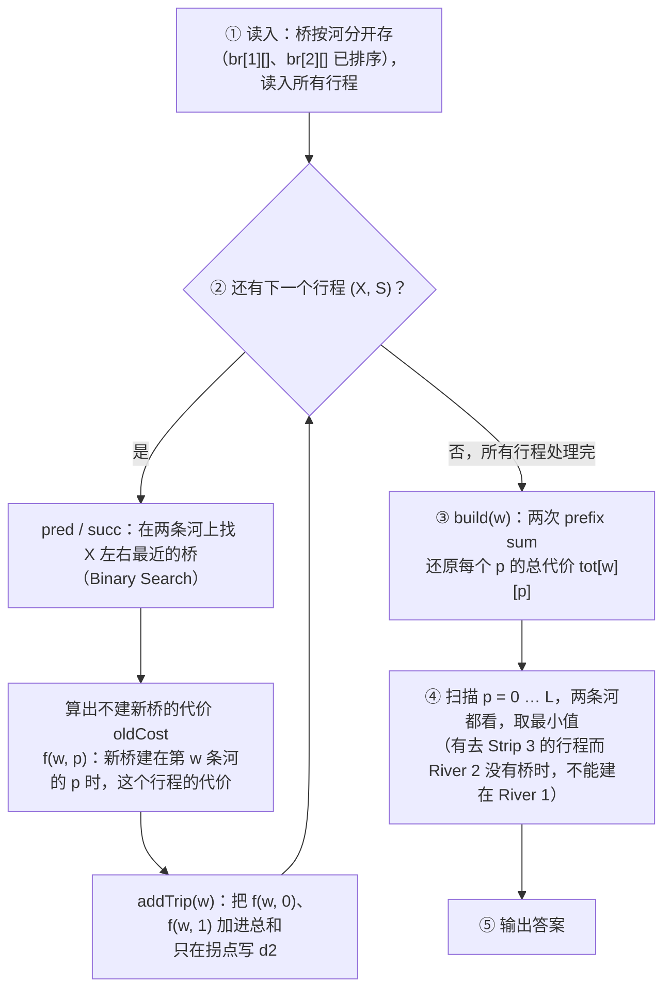

# AIO Problem 6（2019–2026）教学讲义（含相关第 5 题）

> **用途：** 给学生逐步讲解每道 Problem 6 的思路。
> **P6 各节统一结构：** ① 题意转化 → ② 从暴力开始 → ③ 关键观察（Key Observation）→ ④ 算法步骤 → ⑤ 样例手算 → ⑥ 代码导读 → ⑦ 复杂度 → ⑧ 常见错误 → ⑨ Subtask 台阶与课堂提问
> **第 5 题各节：** 紧跟在配对的 P6 后面，重点讲两题的共同核心与不同之处，再配样例手算、代码要点、Subtask 台阶与课堂提问。
> 
> 题面来源：ORAC（orac2.info/hub/aio）。配套 C++ 解答在同一文件夹（`20xx_P6_*.cpp` 和 `20xx_P5_*.cpp`），均已通过官方样例，并用随机小数据与暴力程序的结果比对验证。
> 
> **代码风格：** 与课程示例程序一致：`#include <bits/stdc++.h>`、全局数组（下标从 1 开始）、`cin`/`cout`；二分统一用 `while (l <= r)` 的闭区间模板；不用 `vector`/`set`/`pair`、lambda、`auto` 等新特性和模板类型，只用 `sort`、`min`/`max`、`memset`/`fill` 这类基本函数（唯一的例外是 Twin Rivers：桥数、关键点个数事先不知道，用 `vector` 省掉计数器）。
> 
> **每道题的复杂度阶梯：** 每道题的 slides 末尾都有一页 complexity recap（复杂度回顾），按"暴力 → 中间做法 → 正解"列出复杂度和运算量。本讲义每节的 ⑦（或"复杂度阶梯"）与之一一对应，讲课时可以用它收尾：每一级省掉了什么，靠的是哪个技巧。
> 
> **配套图片：** `Figures/` 文件夹里有课上用到的图（Twin Rivers 的拐点图、两个槽的图、Mundane Square 的流网络图和水位线图等），`Mundane Square Flow Lab.html` 是可交互的最大流演示网页。

---

## 0. 总览

### 0.1 与四大技能的对应

| 年份   | 题目                                  | Greedy    | Two Pointers | Binary Search | Prefix Sum | 其他核心方法                           | 难度    |
| ---- | ----------------------------------- | --------- | ------------ | ------------- | ---------- | -------------------------------- | ----- |
| 2019 | Lollipops, Sweets and Chocolates II |           | ✅            | ✅ 主           |            | 单调性证明                            | ★★★   |
| 2020 | Beach Umbrellas                     | ✅ 主       |              |               |            | Exchange Argument、Binary Lifting | ★★★★★ |
| 2021 | Laser Cutter                        |           | ✅（可选）        | ✅ 主           |            | 单调 staircase                     | ★★★   |
| 2022 | Spaceship Shuffle                   | ✅（median） |              |               | ✅ 主        | 环形 → 链                           | ★★★   |
| 2023 | Yet Another Lights Problem          |           |              |               |            | Parity / GF(2) 构造                | ★★★★  |
| 2024 | Atlantis III: Twin Rivers           |           |              | ✅             | ✅ 主（二阶）    | 分段线性函数                           | ★★★★  |
| 2025 | Robot Writing                       | ✅ 主（关键观察） |              | ✅             |            | Sparse Table、按层推进                | ★★★★  |
| 2026 | Mundane Square                      | ✅ 主       |              | ✅             |            | Gale–Ryser 可行性                   | ★★★★  |

### 0.2 讲课顺序（即本讲义的章节顺序，与 4 次课的 slides 一致）

全部内容分成 4 次课，每次约 2 小时，每次课集中练一到两个核心技能。第 5 题都放在相关的 P6 旁边：先在 P6 里讲透一个想法，再用较短的第 5 题巩固，并对比两题的异同。

| 课次                                 | 节   | 题目                           | 这一节的重点                                          |
| ---------------------------------- | --- | ---------------------------- | ----------------------------------------------- |
| 第 1 次：Prefix Sum                   | 1   | 2022 P6 Spaceship Shuffle    | Prefix Sum、环 → 链、中位数                            |
|                                    | 2   | 2024 P5 Tennis Robot II      | 把循环压缩成"一轮的净变化"，再用除法算出轮数                         |
|                                    | 3   | 2024 P6 Twin Rivers          | 二阶差分 + 两次 Prefix Sum                            |
| 第 2 次：Binary Search + Two Pointers | 4   | 2021 P6 Laser Cutter         | 二分答案（单调性由题目给出）                                  |
|                                    | 5   | 2021 P5 Space Mission        | 前缀最小值：自己制造单调性，再二分                               |
|                                    | 6   | 2019 P6 Lollipops II         | 不单调的条件 → 单调的总和；Two Pointers                     |
| 第 3 次：Greedy（水位线）                  | 7   | 2026 P6 Mundane Square       | 水位线（削峰）+ 二分 + 逐行 Greedy                         |
|                                    | 8   | 2023 P5 Wheeling and Dealing | 水位线（削峰）+ 枚举                                     |
|                                    | 9   | 2026 P5 Prime Minister       | 水位线（填谷）+ 二分答案；三题对比                              |
|                                    | 9A  | 课外读物：Fenwick tree               | 树状数组、lowbit、在树上往下走求"最便宜的 $t$ 个"（Wheeling 补买的 $O(\log C)$ 做法） |
| 第 4 次：Sparse Table + Greedy        | 10  | 2020 P5 Ladybugs II          | 连续窗口 + 二分定位 + 第一次用 Sparse Table                 |
|                                    | 11  | 2025 P6 Robot Writing        | 关键观察 + Sparse Table（第二次用）                       |
|                                    | 12  | 2020 P6 Beach Umbrellas      | 综合压轴：Greedy + Exchange Argument，课上讲到 Subtask 4  |
| 选讲                                 | 13  | 2023 P6 Yet Another Lights   | 奇偶性构造，不用四大技能，作为课后阅读                             |

- 第 1、2 次课：一个观察 + 一个模板，最适合入门。
- 第 3 次课：需要先"化简"，再套模板。
- 第 4 次课：引入 Sparse Table，并以全套最难的 Beach Umbrellas 收尾。
- 第 13 节：纯数学构造，适合单独一节"奇偶性"课。

### 0.3 给学生的解题三问

每道题开始前，先让学生回答：

1. **暴力做法是什么？** 它的复杂度是多少？慢在哪里？（暴力往往就是前几个 subtask 的分数，也是之后用来比对答案的暴力程序。）
2. **有没有什么量是单调的？** 有 → 考虑 Binary Search 或 Two Pointers。
3. **有没有什么量可以累加、拆分或局部决定？** 有 → 考虑 Prefix Sum 或 Greedy。

P6 很少能"直接套模板"。四大技能只是骨架，真正的难点在于先找到 **key observation**，把题目化简成可以套模板的形式。

### 0.4 历年第 5 题：哪些可以结合进来

第 5 题通常只用到 P6 的"一半"：同样的核心技能，但化简步骤更短。本讲义把能结合的第 5 题都放在它配对的 P6 后面：先在 P6 里讲透一个想法，再用第 5 题巩固，并对比两题的异同。

| 年份   | 第 5 题                | 核心方法                                | 是否结合       | 配对的 P6 / 章节                                      |
| ---- | -------------------- | ----------------------------------- | ---------- | ------------------------------------------------ |
| 2019 | Evading Capture      | BFS + 奇偶性（到每个城市的奇数步、偶数步最短距离）        | 不作为主线，可作延伸 | 奇偶性可对照 2023 P6、2025 P6 的"来回走消耗步数"                |
| 2020 | Ladybugs II          | 连续窗口 + Binary Search + Sparse Table | ✅ 第 10 节   | 2020 P6（连续段）、2019 P6（二分定位）、2025 P6（Sparse Table） |
| 2021 | Space Mission        | 前缀最小值 + Binary Search               | ✅ 第 5 节    | 2021 P6、2019 P6（制造单调性）                           |
| 2022 | Composing Pyramids   | 按数值递推（DP）                           | 不结合        | 不在四大技能主线上                                        |
| 2023 | Wheeling and Dealing | 枚举水位线 + Greedy + 按花费分桶              | ✅ 第 8 节    | 2026 P6                                          |
| 2024 | Tennis Robot II      | 一轮的净变化（Prefix Sum）+ 除法算轮数           | ✅ 第 2 节    | 2022 P6（循环 / 净流量）                                |
| 2025 | Pairing Cards        | 把"差为 $D$、和为 $S$"看成图的边，做配对分析             | 不结合        | 偏图论与构造，不在四大技能主线上                                 |
| 2026 | Prime Minister       | Binary Search on Answer + 水位线（填谷）   | ✅ 第 9 节    | 2026 P6、2023 P5                                  |

配套文件：`2020_P5_Ladybugs_II.cpp`、`2021_P5_Space_Mission.cpp`、`2024_P5_Tennis_Robot_II.cpp`、`2026_P5_Prime_Minister.cpp`。四份解答都通过了官方样例，并与暴力程序的结果比对验证过（Ladybugs II 的暴力解枚举所有 $K$ 只瓢虫的组合，不预设"连续"）。

---

## 1. 2022 P6 — Spaceship Shuffle（建议第一个讲）

**技能：Prefix Sum（主）+ Greedy（median 性质）**
**文件：** `2022_P6_Spaceship_Shuffle.cpp`

### ① 题意转化

$N$ 个 cabin 围成一个圈。第 $i$ 个 cabin 现在有 $A_i$ 人，需要变成 $B_i$ 人。每让一个人走到相邻 cabin 花 \$1。求最少花费。

换一种说法：圈上有 $N$ 条边（$i \to i+1$，以及 $N \to 1$）。设每条边上"净流过"的人数为 flow（可正可负，正表示顺时针）。**总花费 = 每条边上 $\lvert \mathrm{flow} \rvert$ 之和。**

为什么只看净流量？如果同一条边上既有人往左又有人往右，让他们"互相抵消"（交换身份）一定不会更差。所以最优解里每条边只有一个方向。

### ② 从暴力开始

先看简单情况 **Subtask 2：不经过 $N \to 1$ 这条边**（相当于把圈剪成一条链）。

链上，边 $i \to i+1$ 左边的所有 cabin 多出来的人，必须全部通过这条边送到右边。所以：

  $\mathrm{flow}_i = (A_1 - B_1) + (A_2 - B_2) + \dots + (A_i - B_i) =$ **$P_i$**（prefix sum）

答案 = $\sum_i \lvert P_i \rvert$。这是一道非常经典的 prefix sum 题，$O(N)$。

### ③ 关键观察

回到圆圈。设 $N \to 1$ 这条边上的流量为 $f$（从 $N$ 流向 1）。那么 cabin 1 相当于"多拿到了 $f$ 个人"，于是每条边的流量都整体加上 $f$：

  $\mathrm{flow}_i = P_i + f$   （$i = 1, \dots, N$，其中 $P_N = 0$，所以 $\mathrm{flow}_N = f$ 也符合公式）

总花费 = $\sum_i \lvert P_i + f \rvert$。

**问题变成：选一个整数 $f$，使 $\sum_i \lvert P_i - (-f) \rvert$ 最小。**

这就是经典的"数轴上选一个点，使它到所有点距离之和最小" → 选 **中位数（median）**。

**为什么是中位数？（给学生的直观解释）**
想象数轴上有若干点，你站在位置 $x$。把 $x$ 往右移一格：左边的每个点距离 $+1$，右边的每个点距离 $-1$。只要右边的点比左边多，往右移就更好。当左右一样多时就停下——那正是中位数的位置。

所以取 $-f = \mathrm{median}(P)$，答案 = $\sum_i \lvert P_i - \mathrm{median} \rvert$。

**用数字验证（样例 1，$P$ = −1 0 0 1 1 2，排好序）：** 站在不同的位置，算到所有点的距离之和：

| 站在   | −1              | 0               | 1               | 2               |
| ---- | --------------- | --------------- | --------------- | --------------- |
| 距离之和 | $0 + 1 + 1 + 2 + 2 + 3 = 9$ | $1 + 0 + 0 + 1 + 1 + 2 = 5$ | $2 + 1 + 1 + 0 + 0 + 1 = 5$ | $3 + 2 + 2 + 1 + 1 + 0 = 9$ |

最小值 5 出现在 0 和 1 之间（偶数个点时，两个中位数之间任何位置都一样好）。这就是 Greedy：一直往更好的方向走一步，直到走不动为止。

### ④ 算法步骤

1. 计算 $P_i = \sum_{k \le i} (A_k - B_k)$，$i = 1, \dots, N$。
2. 把 $P$ 复制一份排序，取中间的那个作为中位数 $\mathrm{med}$。
3. 答案 = $\sum_i \lvert P_i - \mathrm{med} \rvert$。

### ⑤ 样例手算

**样例 1：** $A$ = 5 2 1 6 5 1，$B$ = 3 3 2 7 3 2

| $i$     | 1   | 2   | 3   | 4   | 5   | 6   |
| ----- | --- | --- | --- | --- | --- | --- |
| $A - B$ | 2   | −1  | −1  | −1  | 2   | −1  |
| $P_i$  | 2   | 1   | 0   | −1  | 1   | 0   |

- 排序：−1, 0, 0, 1, 1, 2，中位数取 1（取 0 也一样）。
- $\sum \lvert P - 1 \rvert = 1 + 0 + 1 + 2 + 0 + 1 =$ **5** ✅
- 对比"剪断 $N \to 1$"（$f = 0$）：$\sum \lvert P \rvert = 2 + 1 + 0 + 1 + 1 + 0 = 5$，恰好也是 5。

**样例 2：** $A$ = 5 0 0 0 0，$B$ = 1 1 1 1 1

- $A - B$ = 4 −1 −1 −1 −1，$P$ = 4 3 2 1 0。
- 中位数 = 2，$\sum \lvert P - 2 \rvert = 2 + 1 + 0 + 1 + 2 =$ **6** ✅
- 如果只能往一个方向走（$f = 0$），$\sum \lvert P \rvert = 10$。说明让人从 cabin 1 往两边走更省——这正是"圈"的意义。

### ⑥ 代码导读

```cpp
// Prefix Sum：p[i] 是边 i -> i+1 的流量（先不考虑环）
for (int i = 1; i <= n; i ++){
    p[i] = p[i-1] + a[i] - b[i];
    q[i] = p[i];
}

// 花费 = sum |p[i] - med|，med 取中位数最小
sort(q + 1, q + n + 1);
long long med = q[(n + 1) / 2];

long long ans = 0;
for (int i = 1; i <= n; i ++){
    if (p[i] > med)
        ans += p[i] - med;
    else
        ans += med - p[i];
}
```

### ⑦ 复杂度

$O(N \log N)$（瓶颈是排序；prefix sum 和求和都是 $O(N)$）。

**复杂度阶梯**（$N \le 10^5$，$A_i, B_i \le 10^5$）：

| 做法                             | 复杂度          | 运算量                                    |
| ------------------------------ | ------------ | -------------------------------------- |
| 枚举经过边 $N \to 1$ 的流量 $f$（$\lvert f \rvert$ 可达 $\sum A \approx 10^{10}$，每个 $f$ 算一次） | $O(N \cdot \sum A)$ | $\approx 10^{15}$ ✗ |
| 最优的 $f$ 一定是某个 $-P_i$，只试这 $N$ 个 | $O(N^2)$     | $10^{10}$ ✗                            |
| Prefix Sum 求出 $P_i$，取中位数（一次排序） | $O(N \log N)$ | $\approx 1.7 \times 10^6$ ✓             |

Prefix Sum 把环变成数轴上的点；Greedy（中位数）不用一个一个试 $f$ 就选出最优的那个。

### ⑧ 常见错误

- 用 `int`：$P$ 最大可到 $10^5 \times 10^5 = 10^{10}$，答案更大，**必须用 `long long`**。
- 以为"只能单方向走"，漏掉 $f$ 这个自由度。
- 试图枚举 $f$ 的所有可能值（范围可达 $10^{10}$），超时。

### ⑨ Subtask 台阶与课堂提问

- Subtask 1（所有人都在 cabin 1）：只需决定向左送多少、向右送多少——可以枚举，引出 $f$ 的概念。
- Subtask 2（不经过 $N \to 1$）：纯 prefix sum。
- Subtask 3（$N \le 1000$）：枚举 $f \in [-\text{某范围}, \text{某范围}]$ 并不容易界定范围，引导学生思考 "$f$ 最优一定取某个 $-P_i$"，于是 $O(N^2)$。
- Subtask 4：中位数。

**提问：**

1. 为什么 $\mathrm{flow}_N = f$ 也满足 $P_N + f$ 的公式？（因为 $\sum A = \sum B$，$P_N = 0$。）
2. 如果每条边的单价不同（第 $i$ 条边每人 $w_i$ 元），还能用中位数吗？（→ 带权中位数 weighted median。）

---

## 2. 2024 P5 — Tennis Robot II（接第 1 节：一轮的净变化）

**配对：** 2022 P6 Spaceship Shuffle（第 1 节）
**文件：** `2024_P5_Tennis_Robot_II.cpp`

**题意：** $N$ 个箱子，第 $i$ 个有 $X_i$ 个球。机器人按 $M$ 条指令循环执行：第 $j$ 条把一个球从箱子 $A_j$ 移到 $B_j$。如果要从空箱子取球，机器人就停下。问它停下前成功执行了多少条指令；永远不停输出 FOREVER。

**从暴力开始：** 直接模拟。但机器人可能跑 $10^6$ 轮、每轮 $2 \times 10^5$ 条指令，总步数可达 $2 \times 10^{11}$，太慢。

**关键观察：**

1. **看一轮的净变化。** 把 $M$ 条指令走一遍（不管球数），对每个箱子 $i$ 记录：
   - $d_i$：一轮下来的净变化（进来的减去出去的）；
   - $\mathrm{mn}_i$：每次从它取球**之前**，它相对这一轮开始时的变化的最小值（这是一轮内的"前缀和最小值"）。
2. **第 $r$ 轮开始时**箱子 $i$ 有 $X_i + (r-1)d_i$ 个球。这一轮不会在箱子 $i$ 出问题 $\iff$ $X_i + (r-1)d_i + \mathrm{mn}_i \ge 1$。
3. **直接解这个不等式。** 记 $s_i = X_i + \mathrm{mn}_i$（第 1 轮里箱子 $i$ 的最低点）：
   - $s_i < 1$：第 1 轮就出问题，最多完整跑 0 轮；
   - $d_i \ge 0$：每轮不减少，永远不会出问题；
   - $d_i < 0$：$r - 1 \le \dfrac{s_i - 1}{-d_i}$，所以箱子 $i$ 最多撑 $t_i = \left\lfloor \dfrac{s_i - 1}{-d_i} \right\rfloor + 1$ 轮。
4. 能完整跑完的轮数 $R = \min_i t_i$（只看被取过球的箱子）。如果没有任何箱子会出问题，输出 FOREVER。
5. 找到 $R$ 后，从第 $R + 1$ 轮开始时的球数出发，**只模拟一轮**，找到停下来的那条指令。答案 = $R \cdot M$ + 这一轮成功的条数。

不需要二分：每个箱子的"最多撑几轮"都是一次函数的不等式，一次整数除法就能算出来。

**共同核心：把循环压缩成"一轮的净变化"。**

- 2022 P6：一圈 cabin 上，每条边的流量 = prefix sum + 一个整体偏移 $f$。
- 2024 P5：一轮指令后，每个箱子的球数 = $\text{初始值} + (\text{轮数} - 1) \times$ 净变化 $d_i$；一轮之内的最低点由 prefix sum 的最小值 $\mathrm{mn}_i$ 决定。

**不同之处：**

|               | 2024 P5 Tennis Robot II                 | 2022 P6 Spaceship Shuffle |
| ------------- | --------------------------------------- | ------------------------- |
| "循环"是什么       | 时间上的循环（指令一轮一轮重复）                        | 空间上的循环（cabin 围成一圈）        |
| Prefix Sum 用来 | 求一轮内每个箱子的最低点 $\mathrm{mn}_i$ 和净变化 $d_i$ | 求每条边的流量 $P_i$              |
| 之后怎么做         | 用除法算出"能完整跑完几轮"，再模拟一轮                    | 取中位数，一步算出答案               |

**样例手算（样例 3）：** $X$ = 3 2 6 4 5，指令：$1 \to 5$、$4 \to 3$、$2 \to 3$、$4 \to 2$。

走一遍指令，记录每个箱子"取球前的变化"：

| 箱子  | 被取球时的变化            | $\mathrm{mn}_i$ | $d_i$ | $s_i = X_i + \mathrm{mn}_i$ | 最多撑几轮 $t_i$         |
| --- | ------------------ | --------------- | ----- | --------------------------- | ------------------- |
| 1   | 指令 1 前：0           | 0               | −1    | 3                           | $(3 - 1) / 1 + 1 = 3$ |
| 2   | 指令 3 前：0           | 0               | 0     | 2                           | $d_i = 0$，永远没问题     |
| 3   | 没被取过               | —               | +2    | —                           | —                   |
| 4   | 指令 2 前：0，指令 4 前：−1 | −1              | −2    | 3                           | $(3 - 1) / 2 + 1 = 2$ |
| 5   | 没被取过               | —               | +1    | —                           | —                   |

- $R = \min(3, 2) = 2$，最多完整跑完 2 轮。
- 第 3 轮开始时：箱子 1 有 $3 - 2 = 1$ 个，箱子 4 有 $4 - 4 = 0$ 个。
- 第 3 轮：指令 1（$1 \to 5$）成功；指令 2 要从箱子 4 取球，空了，停。
- 答案 = $2 \times 4 + 1 =$ **9** ✅

**代码要点：**

```cpp
// 每个箱子最多能完整撑几轮，取最小值
long long R = -1;                       // -1 表示没有箱子会出问题
for (int i = 1; i <= n; i ++)
    if (take[i]){
        long long s = x[i] + mn[i];     // 第 1 轮里的最低点
        long long t;
        if (s < 1)
            t = 0;                      // 第 1 轮就出问题
        else if (d[i] >= 0)
            continue;                   // 永远不会出问题
        else
            t = (s - 1) / (-d[i]) + 1;  // 整数除法
        if (R == -1 || t < R)
            R = t;
    }
if (R == -1){
    cout << "FOREVER" << endl;
    return 0;
}
```

答案可达 $10^6 \times 2 \times 10^5 = 2 \times 10^{11}$，要用 `long long`。

**四大技能：** Prefix Sum（一轮内的前缀最小值与净变化）。轮数用一次除法直接算出，不需要二分。

**复杂度阶梯**（$N, M \le 2 \times 10^5$，$X_i \le 10^6$）：

| 做法                                                  | 复杂度                   | 运算量                      |
| --------------------------------------------------- | --------------------- | ------------------------ |
| 一条一条指令模拟，直到某个箱子空了                                   | $O(\text{轮数} \cdot M)$ | 最多约 $2 \times 10^{11}$ ✗  |
| 用 Prefix Sum 概括一轮（$\mathrm{mn}_i$、$d_i$），再二分"能撑过几轮" | $O((N + M) \log X)$      | $\approx 8 \times 10^6$ ✓ |
| 用 Prefix Sum 概括一轮，每个箱子一次除法算出 $t_i$，再只模拟一轮           | $O(N + M)$              | $\approx 4 \times 10^5$ ✓ |

为什么不用模拟前 $R$ 轮？每一轮对每个箱子的影响都一样（都是 $d_i$），可以直接乘。

**Subtask 台阶：** Subtask 1（数据小）直接模拟；Subtask 2（每条指令从不同箱子取球）每个箱子一轮只被取一次，$\mathrm{mn}_i$ 就是取球前的变化，更容易想到"按轮计算"；Subtask 3 一般情况。

**提问：**

1. 为什么 $d_i \ge 0$ 的箱子永远不会让机器人停下？（前提是第 1 轮就没问题，即 $s_i \ge 1$。）
2. 如果所有箱子的 $d_i$ 都 $\ge 0$，会发生什么？
3. 公式里为什么是 $s_i - 1$ 而不是 $s_i$？用箱子 4（$s_4 = 3$，$d_4 = -2$）验证：第 2 轮最低点 $3 - 2 = 1 \ge 1$，第 3 轮 $3 - 4 = -1 < 1$。
4. 这题也可以二分"能完整跑完几轮"（条件关于 $R$ 单调）。和除法相比，哪种写法更简单、更不容易出错？

---

## 3. 2024 P6 — Atlantis III: Twin Rivers（第 1 次课收尾：Prefix Sum 进阶）

**技能：Prefix Sum（二阶差分，主）+ Binary Search**
**文件：** `2024_P6_Twin_Rivers.cpp`

### ① 题意转化

城市有 3 条长条形陆地（Strip 1、2、3），中间隔着 River 1、River 2，桥长 1 km。有 $N$ 座已有的桥和 $T$ 个行程：每个行程从 Strip 1 的位置 $X$ 出发，到 Strip $S$（2 或 3）的同一位置 $X$。你要再建一座桥（任选一条河、任选整数位置 $p$），使所有行程距离之和最小。

### ② 先算清楚一个行程的距离

**去 Strip 2（只过 River 1）：** 从 $X$ 走到某座桥 $b$，过桥，再走回 $X$。
  距离 $= \lvert X - b \rvert + 1 + \lvert b - X \rvert =$ **$1 + 2 \cdot \lvert X - b \rvert$**
最优的 $b$ 显然是 $X$ 左右最近的 River 1 桥。

**去 Strip 3（过两条河）：** 从 $X$ 走到 River 1 的桥 $b_1$，过桥，走到 River 2 的桥 $b_2$，过桥，再走回 $X$。水平距离 $= \lvert X - b_1 \rvert + \lvert b_1 - b_2 \rvert + \lvert b_2 - X \rvert$。
这三段恰好是"从 $X$ 出发、经过 $b_1$、$b_2$、回到 $X$"的一圈，等于三个点所覆盖区间长度的两倍：
  距离 $=$ **$2 + 2 \cdot (\max(X, b_1, b_2) - \min(X, b_1, b_2))$**

对每一条河，最优的桥只可能是 $X$ **左边最近** 或 **右边最近** 的那座（更远的桥只会让区间更长）。
→ 用 **Binary Search** 在排好序的桥数组中找 pred（左边最近）和 succ（右边最近）。

### ③ 从暴力开始

枚举新桥的河（2 种）和位置 $p$（$L + 1$ 种），对每个 $p$ 重新计算每个行程的距离：$O(L \cdot T)$，$L$、$T$ 都到 $2 \times 10^5$ 时是 $4 \times 10^{10}$，太慢。只能过 Subtask 1。

### ④ 关键观察

**观察 1：每个行程的新距离 $w(p)$ 是 $p$ 的一个"简单"函数。**

- 去 Strip 2、新桥建在 River 1：$w(p) = \min(\mathrm{old}, 1 + 2\lvert X - p \rvert)$。这是一个"V 字形，但被 $\mathrm{old}$ 截平"的函数。
- 去 Strip 3、新桥建在 River 1、配合 River 2 上左边最近的桥 $u_2$：
  代价 $= 2 + 2 \cdot (\max(X, p, u_2) - \min(X, p, u_2))$。
  当 $p$ 在 $[u_2, X]$ 之间时，这个值是常数 $2 + 2(X - u_2)$；$p$ 离开这个区间时，每离开 1 km 增加 2。
  我们把这种函数叫做 **trough（槽形函数）**：一段平底，两边斜率 $\pm 2$。
- 同理配合右边最近的桥 $v_2$ 得到另一个 trough。$w(p) = \min(\mathrm{old}, \mathrm{trough}_1, \mathrm{trough}_2)$。

**观察 2：这些函数的斜率只可能是 $-2$、$0$、$+2$，而且每个函数只有 $O(1)$ 个转折点。**

**观察 2'：两个槽不会分开，所以拐点很少。**

去 Strip 3 的行程（新桥在 River 1）有两个槽：配合左边最近的桥 $a$ 的槽，平底是 $[a, X]$；配合右边最近的桥 $b$ 的槽，平底是 $[X, b]$。学生常问：两个槽会不会分开，形成两个"坑"？不会：

1. **平底在 $X$ 处相接。** $a \le X \le b$，两段平底都以 $X$ 为端点。
2. **两条折线一定相交一次。** 在 $a$ 左边，经过 $a$ 一定更短（都要往右走，$a$ 比 $b$ 近）；在 $b$ 右边，经过 $b$ 一定更短。两端较短的走法不同，中间必然交叉。交点满足 $X - a = b - p$，即 $p = a + b - X$，一定在 $[a, b]$ 里：$a$ 更近时交点在 $X$ 和 $b$ 之间，$b$ 更近时在 $a$ 和 $X$ 之间，一样近时就是 $X$（两段平底一样高，连成一段）。
3. **所以两槽取最小只有一个坑：** 在 $X$ 左边只降不升，在 $X$ 右边只升不降。再和 $\mathrm{oldCost}$ 取最小，左右各最多碰一次 $\mathrm{oldCost}$。这就是后面候选拐点只需要"关键点 $\pm k$"的原因。

特殊情况：$X$ 正好是一座桥时 $a = b = X$，两个槽都退化成以 $X$ 为尖的 V 形。（配套图：`Figures/twin_rivers_two_troughs_en.png`。）

**观察 3：为什么要用二阶差分？**

先算一笔账。最直接的做法是枚举每个 $p$：对每个 $p$ 把所有行程的代价加起来。$p$ 有约 $10^6$ 个，行程有 $2 \times 10^5$ 个，共约 $2 \times 10^{11}$ 次运算，远远超时。

但每个行程的 $w(p)$ 是一条**折线**，只有几个拐点。如果每个行程只记录拐点处的信息（$O(1)$ 个位置），最后再一次性还原出每个 $p$ 上的总代价（$O(L)$），总复杂度就降到 $O(T \log N + L)$（$\log N$ 来自用二分找最近的桥）。下面两步说明怎么做到。

**第 1 步：差分（difference）——记录"在哪里跳了多少"。**
对数组 $a$，定义差分 $D_i = a_i - a_{i-1}$（$a_0 = 0$）。例如：

| $i$   | 1   | 2   | 3   | 4   | 5   | 6   | 7    | 8   |
| ----- | --- | --- | --- | --- | --- | --- | ---- | --- |
| $a_i$ | 3   | 3   | 3   | 7   | 7   | 7   | 2    | 2   |
| $D_i$ | 3   | 0   | 0   | 4   | 0   | 0   | $-5$ | 0   |

- $D$ 只在 $a$ "跳"的地方不为 0。
- 对 $D$ 做一次 prefix sum，就得到原来的 $a$：差分和前缀和互为逆运算。
- 经典用法：把 $a_l, \dots, a_r$ 都加 $v$，只需 `D[l] += v`、`D[r+1] -= v`，每次 $O(1)$，最后做一次 prefix sum。
- 局限：差分只对"阶梯形"（分段常数）的数据省事。如果数据是斜线，每一格都在变，$D$ 处处不为 0，就没有节省了。

**第 2 步：二阶差分（second-order difference）——记录"在哪里拐了多少"。**
对折线，一阶差分就是**斜率**；斜率的差分叫二阶差分，表示斜率变了多少。以样例 1 的行程（$X = 4$，去 Strip 3，新桥建在 River 1）为例：

| $p$                                               | 1   | 2    | 3    | 4    | 5   | 6    | 7   |
| ------------------------------------------------- | --- | ---- | ---- | ---- | --- | ---- | --- |
| $w(p)$                                            | 6   | 6    | 4    | 2    | 4   | 6    | 6   |
| 斜率 $w(p) - w(p-1)$                                | —   | 0    | $-2$ | $-2$ | 2   | 2    | 0   |
| $\mathrm{d2}_p = w(p+1) - 2w(p) + w(p-1)$         | —   | $-2$ | 0    | 4    | 0   | $-2$ | —   |

- 斜率在大部分位置都不为 0，但 $\mathrm{d2}$ 只在拐点 $p = 2$、4、6 不为 0：两个拐点之间是直线，斜率不变。
- 所以每个行程只需要在 $O(1)$ 个位置写 $\mathrm{d2}$。
- 多个行程的 $\mathrm{d2}$ 可以直接相加（总代价的二阶差分 = 各行程二阶差分之和），所有行程都写进同一个 $\mathrm{d2}$ 数组。

**还原：两次 prefix sum。** 从 $w(0)$、$w(1)$ 出发：$\mathrm{d2}$ 做一次 prefix sum 得到每个位置的斜率，斜率再做一次 prefix sum 得到 $w(p)$。代码把这两步合成一行：

   $\mathrm{total}(q+1) = 2 \cdot \mathrm{total}(q) - \mathrm{total}(q-1) + \mathrm{d2}_q$

即 $\mathrm{total}(q+1) - \mathrm{total}(q) = (\mathrm{total}(q) - \mathrm{total}(q-1)) + \mathrm{d2}_q$："新斜率 = 旧斜率 + 斜率变化"。

**小结：** 差分数组 + 一次前缀和能还原"分段常数"；**二阶差分 + 两次前缀和能还原"分段线性"**。复杂度从 $O(L \cdot T)$ 降到 $O(T \log N + L)$。

### ⑤ 样例手算（样例 1）

桥：River 1 在 2、6；River 2 在 4。行程：(3,→3)、(4,→3)、(5,→3)、(5,→2)。

先算原始距离：

- (4, →3)：$b_1 \in \{2, 6\}$，$b_2 = 4$。$b_1 = 2$：区间 $[2, 4]$，长 2 → $2 + 4 = 6$。$b_1 = 6$：区间 $[4, 6]$ → 6。$\mathrm{old} = 6$。
- (5, →2)：最近的 River 1 桥是 6，距离 1 → $1 + 2 = 3$。

在 River 1 的 $p = 4$ 建新桥：

- (4, →3)：$b_1 = 4$，$b_2 = 4$ → $2 + 0 =$ **2**（原来 6）。
- (3, →3)：$b_1 = 4$，$b_2 = 4$ → 区间 $[3, 4]$ → $2 + 2 =$ **4**（原来 6）。
- (5, →3)：同理 **4**。
- (5, →2)：新桥在 4，距离 1 → 仍是 **3**。

总和 $2 + 4 + 4 + 3 =$ **13** ✅

**用二阶差分理解 (4, →3)：** 新桥在 River 1，配合 $u_2 = v_2 = 4$，trough 是 $[4, 4]$ 上高度 2、两边斜率 $\pm 2$，再与 $\mathrm{old} = 6$ 取 min：
$w(p) = 6, 6, 4, 2, 4, 6, 6, \dots$（$p = 1, 2, 3, 4, 5, 6, 7$）。转折点只在 $p = 2$、4、6 附近。

### ⑥ 代码导读

**先看整体流程（流程图）：** 程序分 5 步，第 ② 步对每个行程循环一次。



如果阅读器不显示 Mermaid 图，可以看下面的文字版：

```
① 读入桥和行程
② 对每个行程 (X, S)：
      ├─ pred / succ：两条河上 X 左右最近的桥        [Binary Search]
      ├─ oldCost：不建新桥时的最短路程
      └─ addTrip(1)、addTrip(2)：只在拐点写 d2
③ build(1)、build(2)：两次 prefix sum → tot[w][p]   [Prefix Sum]
④ 扫描所有 p，取最小值
⑤ 输出
```

**高层伪代码：**

```
① 读入桥，每条河的桥排好序；读入所有行程
② for 每个行程 (X, S):
       u1, w1 = pred(1, X), succ(1, X)        // Binary Search：River 1 左右最近的桥
       u2, w2 = pred(2, X), succ(2, X)        // River 2 左右最近的桥
       oldCost = 用已有的桥时的最短路程
       addTrip(1);  addTrip(2)                // 只在拐点写 d2
③ build(1);  build(2)                         // 两次 prefix sum → tot[w][p]
④ 扫描 p = 0 … L，取 tot[1][p]、tot[2][p] 的最小值
⑤ 输出

f(w, p)    = 新桥建在第 w 条河的位置 p 时，这个行程的代价
addTrip(w) : tot[w][0] += f(w, 0);  tot[w][1] += f(w, 1)
             对每个候选拐点 q：
                 d2[w][q] += f(w, q+1) − 2·f(w, q) + f(w, q−1)
```

**第一步：一个行程的代价，直接按题意写（不用结构体）。**

```cpp
// 去 Strip 2：走到 River 1 上的桥 a，过桥，再走回 X
long long way2(long long a){
    if (a < 0)
        return INF;                              // 这座桥不存在
    return 1 + 2 * abs(X - a);
}

// 去 Strip 3：用 River 1 上的桥 a 和 River 2 上的桥 b
long long way3(long long a, long long b){
    if (a < 0 || b < 0)
        return INF;
    long long hi = max(X, max(a, b));
    long long lo = min(X, min(a, b));
    return 2 + 2 * (hi - lo);
}

// 新桥建在第 w 条河的位置 p 时，当前行程的最短路程
long long f(int w, long long p){
    long long c = oldCost;
    if (S == 2 && w == 1)                        // 新桥当 River 1 的桥
        c = min(c, way2(p));
    if (S == 3 && w == 1)                        // 新桥当 River 1 的桥
        c = min(c, min(way3(p, u2), way3(p, w2)));
    if (S == 3 && w == 2)                        // 新桥当 River 2 的桥
        c = min(c, min(way3(u1, p), way3(w1, p)));
    return c;
}
```

当前行程的 `X`、`S`、`u1`、`w1`、`u2`、`w2`、`oldCost` 都放在全局变量里，每处理一个行程就更新一次。另一条河上只需要考虑 $X$ 左右最近的两座桥，这正是二分找出来的。用样例 1 的行程（$X = 4$，去 Strip 3）验证：$\mathrm{u2} = \mathrm{w2} = 4$，$\mathrm{oldCost} = 6$，$f(1, p) = \min(6, 2 + 2 \cdot (\max(4, p) - \min(4, p)))$，$p = 1, \dots, 7$ 时为 6 6 4 2 4 6 6，和 ⑤ 的手算一致。

**第二步：拐点在哪里？** $f$ 是若干条直线取 min，斜率只有 $-2$、$0$、$+2$。设 $a$、$b$ 是另一条河上 $X$ 左右最近的桥，$\mathrm{oldCost} = (S - 1) + 2k$。$f$ 只可能在两类地方拐弯：

- **走法改变的地方（关键点）：** $X$、$a$、$b$，以及 $a + b - X$（"用 $a$"和"用 $b$"一样长的位置。例如 $p$ 在 $a$ 和 $X$ 之间时，用 $a$ 的代价是平的 $X - a$，用 $b$ 的代价是 $b - p$，相等时 $p = a + b - X$）。去 Strip 2 的行程只有一个关键点 $X$。
- **碰到 $\mathrm{oldCost}$ 被截平的地方：** 离某个关键点正好 $k$ 步，即关键点 $\pm k$。

因为所有坐标都是整数，这些拐点都在整数上。多取几个候选点也没关系：不是拐点的地方，$f(q+1) - 2f(q) + f(q-1)$ 正好是 0。所以代码对"每个关键点、每个关键点 $\pm k$"都算一次二阶差分即可：

```cpp
// 把当前行程的 f(w, p) 加进第 w 个累加器
void addTrip(int w){
    tot[w][0] += f(w, 0);                        // 还原时需要的两个起点
    if (L >= 1)
        tot[w][1] += f(w, 1);
    ...                                          // 关键点放进 vector<long long> key
    vector<long long> cand;                      // 候选拐点：每个关键点，以及关键点 ± k
    for (int i = 0; i < (int)key.size(); i ++){
        cand.push_back(key[i] - k);
        cand.push_back(key[i]);
        cand.push_back(key[i] + k);
    }
    sort(cand.begin(), cand.end());
    cand.erase(unique(cand.begin(), cand.end()), cand.end());   // 去重
    for (int i = 0; i < (int)cand.size(); i ++){
        long long q = cand[i];
        if (q < 1 || q > L - 1)
            continue;
        d2[w][q] += f(w, q + 1) - 2 * f(w, q) + f(w, q - 1);
    }
}

// 两次 prefix sum 还原
void build(int w){
    for (int q = 1; q + 1 <= L; q ++)
        tot[w][q+1] = 2 * tot[w][q] - tot[w][q-1] + d2[w][q];
}
```

用样例 1 验证（$X = 4$，去 Strip 3，$a = b = 4$，$k = 2$）：关键点只有 4，候选点是 2、4、6，算出的 $\mathrm{d2}$ 是 $-2$、4、$-2$，和 ⑤ 一致。

**两个例子：$f$ 在哪里拐弯？**（配套图：`Figures/twin_rivers_keypoints_en.png`）设 $X = 4$，去 Strip 3，新桥建在 River 1；River 1 原有的桥在 11，所以 $\mathrm{oldCost} = 2 + 2 \cdot (11 - 4) = 16$，$k = 7$。

- **情况 1：River 2 上有 $a = 2$、$b = 7$。** 拐点是 2、4、5、7、11：$a$（进入经过 $a$ 的平底）、$X$（新桥越过出发点，开始变远）、$a + b - X = 5$（经过 $a$ 和经过 $b$ 一样长，之后改走 $b$）、$b$（走出经过 $b$ 的平底）、$X + k = 11$（碰到 $\mathrm{oldCost}$，新桥不再有用）。
- **情况 2：River 2 上只有 $b = 7$（$a = -1$，不存在）。** 只有一个槽，没有切换点 $a + b - X$，拐点只有 4、7、11。左边在 $p = 0$ 碰到 $\mathrm{oldCost}$，对应 $b - k = 0$；它在边界上，程序只在 $1, \dots, L - 1$ 写 $\mathrm{d2}$，$f(0)$ 直接加进 `tot[w][0]`。

**`addTrip` 里为什么要判断 `a >= 0`、`b >= 0`、两者都 `>= 0`？** 不存在的桥用 $-1$ 表示。只有 $a$ 存在时，$a$ 才是关键点；只有 $b$ 存在时，$b$ 才是关键点；只有两座桥**都**存在时，才有"用 $a$ 和用 $b$ 一样长"的切换点 $a + b - X$。如果把 $-1$ 当成真实位置，就会算出错误的候选点（虽然多算的候选点在不拐弯处 $\mathrm{d2}$ 为 0，但 $-1 + b - X$ 这样的点可能恰好落在别的拐点上，逻辑也说不清楚）。

**提问：** 情况 1 中 $p = 1$ 和 $p = 3$ 为什么不是拐点？（左右两段斜率相同，二阶差分是 0；即使把它们当候选点算，结果也是 0。）

**为什么用 vector：** 每条河上的桥数、每个行程的关键点个数（1 到 4 个）、候选点个数事先都不知道。用 `vector` 的 `push_back` 和 `size()`，就不需要另外维护 `nb[]`、`nk`、`nc` 这样的计数器；`sort` + `unique` + `erase` 一行完成去重。`d2`、`tot` 的长度在读入 $L$ 之后才知道，所以也用 `vector`，读入后 `assign(L + 1, 0)`。

**伪代码和程序中函数的对应：**

- `pred(r, v)`、`succ(r, v)`：二分，在第 $r$ 条河的桥数组 `br[r][]` 中找左右最近的桥。
- `way2`、`way3`：按题意算一次行程的路程；`f(w, p)`：新桥在第 $w$ 条河的 $p$ 时，当前行程的代价。
- `addTrip(w)`：只在候选拐点写入 `d2[w][q]`（$w = 1$ 表示新桥建在 River 1，$w = 2$ 表示 River 2）。
- `build(w)`：两次 prefix sum 还原每个 $p$ 的总代价 `tot[w][p]`。
- 最后分别对 River 1、River 2 取最小值。

**特殊情况：** 如果原本没有跨 River 2 的桥，而又存在去 Strip 3 的行程，这些行程原本无法完成，新桥**只能**建在 River 2（代码中 `hasS3` 的判断）。

### ⑦ 复杂度

二分找桥 $O(T \log N)$，累加差分 $O(T)$，还原 $O(L)$：总计 $O(T \log N + L)$。

**复杂度阶梯**（$L \le 10^6$，$N, T \le 2 \times 10^5$）：

| 做法                                                   | 复杂度                     | 运算量                          |
| ---------------------------------------------------- | ----------------------- | ---------------------------- |
| 枚举 $p$，每个行程再扫一遍所有桥                                   | $O(L \cdot T \cdot N)$  | $\approx 4 \times 10^{16}$ ✗ |
| 先用 Binary Search 为每个行程找到最近的桥，再枚举 $p$                 | $O(L \cdot T)$          | $\approx 2 \times 10^{11}$ ✗ |
| 每个行程只在 $O(1)$ 个拐点写 $\mathrm{d2}$，最后两次 prefix sum     | $O(T \log N + L)$       | $\approx 4.6 \times 10^6$ ✓  |

两次 prefix sum 省掉的是"对每个 $p$ 把 $T$ 个行程加一遍"，变成"每个行程只写几个数，最后统一还原"。

### ⑧ 常见错误

- 忘了"只能建在 River 2"的特殊情况（样例 3 就是这种情况）。
- 用 `int` 存总和：$T \times$ 距离可达 $2 \times 10^5 \times 2 \times 10^6$，用 `long long`。
- 漏掉候选拐点：除了 $X$、$a$、$b$，还有 $a + b - X$，以及每个关键点 $\pm k$（$f$ 碰到 $\mathrm{oldCost}$ 的地方）。漏掉一个，还原出来的总代价就会错。
- 对每个 $p$ 重新扫描所有行程（$O(L \cdot T)$）。

### ⑨ Subtask 台阶与课堂提问

| Subtask | 条件                       | 思路                      |
| ------- | ------------------------ | ----------------------- |
| 1       | 小数据，都去 Strip 2           | 暴力枚举 $p$                |
| 2       | 都去 Strip 2               | 每个行程是被截平的 V 形 → 一阶/二阶差分 |
| 3       | 都去 Strip 3，已有桥都在 River 1 | 新桥必须建在 River 2          |
| 4       | 一般情况                     | 折线 $f$ + 二阶差分           |

**提问：**

1. 为什么"经过 $b_1$、$b_2$ 再回到 $X$"的水平距离等于 $2 \times (\max - \min)$？画图说明。
2. 如果只用一阶差分（差分数组 + 一次 prefix sum），能处理什么样的函数？
3. 如果可以建**两座**新桥，思路要怎么改？

---

## 第 2 次课开场：从解空间的形状讲 Binary Search

在讲 Laser Cutter 之前，先不看具体题目，只看**解空间（solution space，也叫 search space）**。

**1. 把所有候选答案排成一行，对每个 $x$ 问 $\mathrm{check}(x)$：** 行（✓）还是不行（✗）。这一行 ✓ / ✗ 有一个"形状"：

| $\mathrm{check}(x)$ | 1   | 2   | 3   | 4   | 5   | 6   | 7   | 8   | 9   | 10  |                       |
| ------------------- | --- | --- | --- | --- | --- | --- | --- | --- | --- | --- | --------------------- |
| 单调                  | ✗   | ✗   | ✗   | ✗   | ✓   | ✓   | ✓   | ✓   | ✓   | ✓   | 一条分界线 → Binary Search |
| 单调                  | ✓   | ✓   | ✓   | ✓   | ✓   | ✓   | ✗   | ✗   | ✗   | ✗   | 一条分界线 → Binary Search |
| 不单调                 | ✗   | ✓   | ✗   | ✗   | ✓   | ✓   | ✗   | ✓   | ✗   | ✗   | 没有分界线 → 只能全部检查        |

单调（monotone）就是"只有一条分界线"。这时查中间的一个 $\mathrm{mid}$，就知道分界线在它左边还是右边，可以扔掉一半。不单调时，查到一个 ✗ 不能说明 ✓ 在哪一边，二分就失效了。**二分找的不是答案本身，而是 ✗ 和 ✓ 的分界线。**

**2. 循环怎么利用这个形状。** 以 ✗✗✗✗✗✗✓✓✓✓（$x = 1, \dots, 10$）为例，用"找第一个 ✓"的模板（check 为真 → $r = \mathrm{mid} - 1$，否则 $l = \mathrm{mid} + 1$）：

| 步   | $l, r$ | $\mathrm{mid}$ | $\mathrm{check}(\mathrm{mid})$ | 更新           |
| --- | ------ | -------------- | ------------------------------ | ------------ |
| 1   | 1, 10  | 5              | ✗                              | $l = 6$      |
| 2   | 6, 10  | 8              | ✓                              | $r = 7$      |
| 3   | 6, 7   | 6              | ✗                              | $l = 7$      |
| 4   | 7, 7   | 7              | ✓                              | $r = 6$，结束   |

循环结束时 **$r$ 停在最后一个 ✗，$l$ 停在第一个 ✓，并且 $l = r + 1$**。所以形状 ✗✗✓✓ 找第一个 ✓ 输出 $l$；形状 ✓✓✗✗ 用另一个写法找最后一个 ✓，输出 $r$。$N$ 个候选只需约 $\log_2 N$ 次 check：10 个 → 4 次，$10^9$ 个 → 约 30 次。如果整行都是 ✗，结束时 $l = N + 1$，要特判"无解"。

**3. 今天三道题的解空间：**

| 题目            | 候选答案              | check                         | 形状      | 输出           |
| ------------- | ----------------- | ----------------------------- | ------- | ------------ |
| Laser Cutter  | 边长 $s$            | 放得下 $s \times s$ 吗？           | ✓✓✓✓✗✗  | 最后一个 ✓ → $r$ |
| Space Mission | 出发日 $t$（固定 $j$）   | $\mathrm{pm}_t \le F - C_j$？  | ✗✗✓✓✓   | 第一个 ✓ → $l$  |
| Lollipops II  | 半径 $R$            | 排序后的计数等于 $s$？                 | ✗✗✗✓✓✗✗ | 不单调，不能直接二分   |
| Lollipops II  | 半径 $R$            | 计数总和 $\ge S$？                 | ✗✗✗✓✓✓✓ | 第一个 ✓ → $l$  |

第 1 次课的 Tennis Robot II 也有同样的形状："箱子 $i$ 能撑过 $r$ 轮吗？"随 $r$ 增大是 ✓✓✓✗✗，只是那里可以用除法直接算出分界线。

## 4. 2021 P6 — Laser Cutter

**技能：Binary Search on Answer（主），可选 Two Pointers**
**文件：** `2021_P6_Laser_Cutter.cpp`

### ① 题意转化

在 $N \times N$ 的木板上，从左上角到右下角有两条只走 R（右）和 D（下）的路径：A 是下边界，B 是上边界，两条路径之间围成一个形状。求能放进这个形状的最大正方形边长（边与木板平行）。

### ② 从暴力开始

- 把形状画成 $N \times N$ 的格子，标出哪些格子在形状内。
- 对每个左上角、每个边长检查。$O(N^4)$ 或用二维前缀和 $O(N^3)$，只能过 $N \le 10$ / $N \le 1000$ 的部分 subtask。
- 而 $N$ 可达 $2 \times 10^5$，连格子都存不下（$4 \times 10^{10}$ 个）。**必须利用形状的特殊结构。**

### ③ 关键观察

**观察 1：用"每一列的上下边界"描述形状。**
沿路径走一遍，每次向右走一格时，记下当前所在的行号：

- $\mathrm{yB}_x$：上边界在第 $x$ 列的位置（B 路径向右经过第 $x$ 列时的行号）；
- $\mathrm{yA}_x$：下边界在第 $x$ 列的位置（A 路径向右经过第 $x$ 列时的行号）。

第 $x$ 列中，形状内的格子是第 $\mathrm{yB}_x$ 行到第 $\mathrm{yA}_x - 1$ 行。

**观察 2：两个边界都单调不减（staircase）。** 路径只能往右、往下走，所以越往右，行号只会越大或不变。

**观察 3：判定一个 $s \times s$ 正方形能否放在第 $x, \dots, x + s - 1$ 列。**

- 正方形的顶边必须在所有列的上边界之下 → 受最严格的那列约束。因为 $\mathrm{yB}$ 单调不减，最严格的是**最右边**一列：$\mathrm{yB}_{x+s-1}$。
- 正方形的底边必须在所有列的下边界之上 → 最严格的是**最左边**一列：$\mathrm{yA}_x$。
- 所以可行 $\iff$ **$\mathrm{yA}_x - \mathrm{yB}_{x+s-1} \ge s$**。

**一个新例子（$N = 8$，不是样例，免得提前给出手算页的答案）：** 沿两条切割线走一遍，得到

| 列 $x$      | 1   | 2   | 3   | 4   | 5   | 6   | 7   | 8   |
| -------- | --- | --- | --- | --- | --- | --- | --- | --- |
| $\mathrm{yb}_x$（顶） | 0   | 0   | 1   | 2   | 2   | 4   | 6   | 7   |
| $\mathrm{ya}_x$（底） | 3   | 5   | 6   | 6   | 7   | 8   | 8   | 8   |

第 3 列占第 $\mathrm{yb}_3 = 1$ 行到第 $\mathrm{ya}_3 - 1 = 5$ 行；两行数字都从左到右单调不减，这就是"阶梯"。在第 2–4 列放一个 $3 \times 3$ 正方形（$x = 2$，$s = 3$）：顶边受最右一列 $\mathrm{yb}_4 = 2$ 限制，底边受最左一列 $\mathrm{ya}_2 = 5$ 限制，$5 - 2 = 3 \ge 3$，放得下。$s = 4$ 时每个 $x$ 都放不下（$x = 1, \dots, 5$ 依次得 1、3、2、0、0，都 $< 4$），所以这个例子的答案是 3。

**观察 4：答案具有单调性。** 放得下 $s \times s$，一定放得下 $(s - 1) \times (s - 1)$。→ **Binary Search on Answer**。

### ④ 算法步骤

1. 模拟两条路径，得到 $\mathrm{yA}_0, \dots, \mathrm{yA}_{N-1}$ 和 $\mathrm{yB}_0, \dots, \mathrm{yB}_{N-1}$。
2. 二分边长 $s \in [1, N]$：
   - $\mathrm{check}(s)$：枚举 $x = 0, \dots, N - s$，看是否存在 $\mathrm{yA}_x - \mathrm{yB}_{x+s-1} \ge s$。$O(N)$。
3. 输出最大的可行 $s$。

### ⑤ 样例手算（样例 2）

$N = 6$，A = `DDDDDDRRRRRR`，B = `RDRRDDDRRRDD`。

- A 先往下走 6 格再往右：$\mathrm{yA}$ = 6 6 6 6 6 6。
- B：R（第 0 列，行 0）→ D → R（第 1 列，行 1）→ R（第 2 列，行 1）→ DDD → R（第 3 列，行 4）→ R（第 4 列，行 4）→ R（第 5 列，行 4）→ DD。
  $\mathrm{yB}$ = 0 1 1 4 4 4。

| $s$   | 检查的 $x$ | $\mathrm{yA}_x - \mathrm{yB}_{x+s-1}$         | 可行？ |
| --- | ----- | ------------------------- | --- |
| 3   | $x = 0$ | $6 - \mathrm{yB}_2 = 6 - 1 = 5 \ge 3$ | ✅   |
| 4   | $x = 0$ | $6 - \mathrm{yB}_3 = 2$             | ❌   |
| 4   | $x = 1$ | $6 - \mathrm{yB}_4 = 2$             | ❌   |
| 4   | $x = 2$ | $6 - \mathrm{yB}_5 = 2$             | ❌   |

答案 **3** ✅。

### ⑥ 代码导读

```cpp
// 模拟路径：每次向右走一格，记下当前的行号
void trace(char p[], int y[]){
    int row = 0, col = 1;
    for (int i = 0; i < 2 * n; i ++){
        if (p[i] == 'D')
            row ++;
        else{
            y[col] = row;
            col ++;
        }
    }
}

// 边长 s 能否放下：存在 x，使 ya[x] - yb[x+s-1] >= s
bool check(int s){
    for (int x = 1; x + s - 1 <= n; x ++)
        if (ya[x] - yb[x + s - 1] >= s)
            return true;
    return false;
}

// 二分：找最大的可行边长
int l = 1, r = n;
while (l <= r){
    int mid = (l + r) / 2;
    if (check(mid))
        l = mid + 1;
    else
        r = mid - 1;
}
cout << r << endl;
```

这是"找最后一个可行值"的写法：循环结束时 `r` 就是最大的可行边长（和课上 timber 一题的写法相同）。

### ⑦ 复杂度

$O(N \log N)$。

**复杂度阶梯**（$N = 2 \times 10^5$）：

| 做法                                  | 复杂度          | 运算量                          |
| ----------------------------------- | ------------ | ---------------------------- |
| 暴力：每个左上角、每个边长，二维前缀和检查               | $O(N^3)$     | $8 \times 10^{15}$ ✗（格子根本存不下） |
| 用阶梯 $\mathrm{yb}$、$\mathrm{ya}$ 描述形状，逐个尝试 $s$，每次检查 $O(N)$ | $O(N^2)$     | $4 \times 10^{10}$ ✗          |
| "放得下"关于 $s$ 单调 → 二分 $s$             | $O(N \log N)$ | $\approx 3.6 \times 10^6$ ✓   |
| 选做：一个只往前走的指针                        | $O(N)$       | $2 \times 10^5$ ✓             |

二分省掉的是"尝试多少个 $s$"（$N$ 个 → 约 18 个），每次检查的 $O(N)$ 没有变。

### ⑧ 常见错误

- 上下边界搞反（哪条是 A、哪条是 B）。
- 判定时取错列：上边界要看**最右**列，下边界要看**最左**列。学生常常两个都看同一列。
- 二分结束后输出了 `l` 而不是 `r`：找"最后一个可行值"时答案是 `r`，找"第一个可行值"时答案是 `l`。

### ⑨ Subtask 台阶与课堂提问

- Subtask 1（左下角在形状内，即 A 先下后右）：$\mathrm{yA}$ 全是 $N$，只需看上边界，更容易想到观察 3。
- Subtask 2、3：暴力 / 二维前缀和。
- Subtask 4：二分。

**提问：**

1. 为什么 $\mathrm{yB}$ 单调意味着"最右列最严格"？画图说明。
2. **进阶（Two Pointers 版本）：** 能否不用二分？提示：对每个 $x$，最大可行的 $s$ 记为 $g(x)$；试着证明可以用一个随 $x$ 单调移动的指针在 $O(N)$ 内求出所有 $g(x)$。（答案：从第 $x$ 列开始能放下 $s \times s$，那么从第 $x + 1$ 列开始一定能放下 $(s - 1) \times (s - 1)$（把原正方形去掉第 $x$ 列、再去掉一行），所以 $g(x + 1) \ge g(x) - 1$。右端点 $x + g(x) - 1$ 因此只会往右走，一个指针扫一遍即可。）

---

## 5. 2021 P5 — Space Mission（接第 4 节：制造单调性）

**配对：** 2021 P6 Laser Cutter（第 4 节）、2019 P6 Lollipops II（第 6 节）
**文件：** `2021_P5_Space_Mission.cpp`

**题意：** 第 $i$ 天用传送门要花 $C_i$ 燃料。选出发日 $i$ 和返回日 $j$（$i < j$），要求 $C_i + C_j \le F$，使天数 $j - i + 1$ 最大；做不到输出 $-1$。

**从暴力开始：** 枚举所有 $(i, j)$，$O(N^2)$，只能过 Subtask 1。

**关键观察：** 固定返回日 $j$，出发日 $i$ 越靠左越好，所以要找"最靠左的 $i$，使 $C_i \le F - C_j$"。$C$ 本身没有单调性，不能直接二分。但换一个问法就有了：

- "前 $t$ 天里**存在**一天花费 $\le \mathrm{need}$" 这件事，随 $t$ 增大只会从"否"变成"是"，是单调的；
- 它等价于 **$\mathrm{pm}_t \le \mathrm{need}$**，其中 $\mathrm{pm}_t = \min(C_1, \dots, C_t)$ 是**前缀最小值**，单调不增。

所以对每个 $j$，在 $\mathrm{pm}_1, \dots, \mathrm{pm}_{j-1}$ 上二分第一个 $\le F - C_j$ 的位置即可。

**共同核心：自己制造单调性。**

- 上一节 2021 P6：两条边界本身就是单调的阶梯，判定条件"边长 $s$ 放得下"也单调——单调性是题目给的。
- 本节 2021 P5：花费数组不能二分，换成**前缀最小值**就单调了——单调性是自己造出来的。
- 下一节 2019 P6：计数向量本身不能二分，换成它的**总和**就单调了——同样是自己造单调性，但更难想到。

**不同之处：**

|        | 2021 P5 Space Mission | 2021 P6 Laser Cutter |
| ------ | --------------------- | -------------------- |
| 二分的对象  | 数组下标（在 $\mathrm{pm}$ 上找位置）       | 答案（正方形边长）            |
| 单调性从哪来 | 自己构造（前缀最小值）           | 题目自带（阶梯形边界）          |
| 二分次数   | 每个 $j$ 一次，共 $N$ 次         | 整体一次，每次 $O(N)$ 检查      |

**样例手算（样例 2）：** $F = 14$，$C$ = 12 8 2 16 4 6 10。

| 天 $i$   | 1   | 2   | 3   | 4   | 5   | 6   | 7   |
| ----- | --- | --- | --- | --- | --- | --- | --- |
| $C_i$ | 12  | 8   | 2   | 16  | 4   | 6   | 10  |
| $\mathrm{pm}_i$ | 12  | 8   | 2   | 2   | 2   | 2   | 2   |

- $j = 6$：$\mathrm{need} = 14 - 6 = 8$，$\mathrm{pm}$ 中第一个 $\le 8$ 的是 $i = 2$ → 天数 5。
- $j = 7$：$\mathrm{need} = 4$，第一个 $\le 4$ 的是 $i = 3$ → 天数 5。
- $j = 4$：$\mathrm{need} = -2$，找不到。

答案 **5** ✅

**代码要点：**

```cpp
pm[1] = c[1];
for (int i = 2; i <= n; i ++)
    pm[i] = min(pm[i-1], c[i]);

for (int j = 2; j <= n; j ++){
    long long need = F - c[j];
    // 二分：最小的 i（1 <= i < j），使 pm[i] <= need（"第一个可行值"，答案是 l）
    int l = 1, r = j - 1;
    while (l <= r){
        int mid = (l + r) / 2;
        if (pm[mid] <= need)
            r = mid - 1;
        else
            l = mid + 1;
    }
    if (l <= j - 1)
        ans = max(ans, j - l + 1);
}
```

**四大技能：** Binary Search（主）+ 前缀最小值（Prefix Sum 的"min 版本"）。

**复杂度阶梯**（$N = 10^5$）：

| 做法                    | 复杂度          | 运算量                        |
| --------------------- | ------------ | -------------------------- |
| 枚举每一对 $(i, j)$        | $O(N^2)$     | $10^{10}$ ✗                |
| 前缀最小值 $\mathrm{pm}$ + 对每个 $j$ 二分 | $O(N \log N)$ | $\approx 1.7 \times 10^6$ ✓ |
| 选做：Two Pointers       | $O(N)$       | $10^5$ ✓                   |

$C$ 本身没有顺序，所以先造一个有顺序的：$\mathrm{pm}$ 只会变小。于是每个 $j$ 只要约 17 次比较，而不是 $j$ 次。如果直接在 $C$ 上二分，会跳过正确答案。

**Subtask 台阶：** Subtask 1（$N \le 1000$）暴力；Subtask 2（$F \le 100$）只有花费 $\le 100$ 的天有用，可以按花费值记录"最早出现的那一天"；Subtask 3 前缀最小值 + 二分。

**提问：**

1. 为什么"前 $t$ 天存在花费 $\le \mathrm{need}$ 的一天"是单调的？$C$ 本身为什么不行？
2. 前缀最小值和 prefix sum 有什么共同点？（都是"把前 $i$ 个数合起来"的一种运算。）
3. 能不能不用二分，用 Two Pointers 做到 $O(N)$？（答案：最优的出发日 $i$ 一定是"前缀最小值创新低"的那一天，最优的返回日 $j$ 一定是"后缀最小值"的那一天。把这两组位置分别列出来：$i$ 往右走时 $C_i$ 变小，允许的 $C_j$ 上限 $F - C_i$ 变大，能用的最远 $j$ 只会往右移，所以一个指针扫一遍即可。）
4. 搜索范围为什么是 $\mathrm{pm}_1, \dots, \mathrm{pm}_{j-1}$ 而不是 $\mathrm{pm}_1, \dots, \mathrm{pm}_j$？（出发日和返回日必须不同，$i < j$。）

---

## 6. 2019 P6 — Lollipops, Sweets and Chocolates II

**技能：Binary Search（主）+ Two Pointers**
**文件：** `2019_P6_Lollipops_II.cpp`

### ① 题意转化

数轴上有 $N$ 个商店和 $M$ 个房子。选一个整数半径 $R$（$0 \le R \le L$），每个房子数一数距离自己不超过 $R$ 的商店有几个。现在给你这 $M$ 个计数，但**顺序被打乱了**（给出的是排好序的列表 $s$）。问：哪个 $R$ 能产生完全相同的一组计数？找不到输出 $-1$。

**要点：** 比较的是 multiset（多重集合）。所以把我们算出的计数排序后，和 $s$ 逐项比较即可。

### ② 从暴力开始

- 枚举 $R = 0, \dots, L$；对每个 $R$ 算出每个房子的计数，排序，与 $s$ 比较。
- 每个 $R$ 需要 $O(M \log M)$，总共 $O(L \cdot M \log M)$。$L$ 可达 $10^9$，太慢。

**瓶颈：$R$ 的取值太多。** 自然的想法：能不能二分 $R$？这需要某种单调性。

### ③ 关键观察

**观察 1：每个房子的计数随 $R$ 单调不减。** 半径变大，圈里的商店只会变多。

**观察 2：排序后的计数向量 $v(R)$ 也逐分量单调不减。** 每个数都没有变小，那么排序后第 $k$ 小的数也不会变小。（很好的小证明练习。）

**观察 3（最关键）：设 $S$ = $s$ 的总和。所有满足 $\mathrm{sum}(v(R)) = S$ 的 $R$，对应的 $v(R)$ 完全相同。**
理由：设 $R_1 < R_2$ 且两者的总和都是 $S$。由观察 2，每个位置的差 $v_k(R_2) - v_k(R_1) \ge 0$；这些差加起来等于 $S - S = 0$。几个非负数的和是 0，只能每个都是 0，所以两个向量完全相同。（反过来：如果 $R_1 < R_2$ 而总和变大了，至少有一个位置严格变大，两个向量一定不同。）

**结论：** 不需要检查每个 $R$。只要：

1. 用 Binary Search 找**最小**的 $R$，使 $\mathrm{sum}(v(R)) \ge S$（总和关于 $R$ 单调，可以二分）；
2. 检查这个 $R$：总和是否恰好为 $S$，且排序后的 $v(R)$ 是否等于 $s$。满足 → 输出 $R$；否则 → 输出 $-1$。

**为什么"否则"就一定无解？**

- 若这个最小 $R$ 的总和已经 $> S$：更大的 $R$ 总和也 $> S$，更小的 $R$ 总和 $< S$，没有任何 $R$ 的总和等于 $S$。
- 若总和 $= S$ 但向量不同：由观察 3，所有总和为 $S$ 的 $R$ 向量都一样，所以全都不行。

### ④ 算法步骤

1. 读入商店、房子（都已排好序）和 $s$，计算 $S = \sum s$。
2. 若 $\mathrm{total}(L) < S$，输出 $-1$。
3. 在 $[0, L]$ 上二分最小的 $R$，使 $\mathrm{total}(R) \ge S$。
4. 计算该 $R$ 下每个房子的计数，排序，与 $s$ 比较。

**如何快速计算 $\mathrm{total}(R)$：Two Pointers。**
房子从左到右处理时，窗口 $[h - R, h + R]$ 的左右端都只会往右移：

- `hi`：第一个**下标**，使 `sh[hi]` $> h + R$；
- `lo`：第一个**下标**，使 `sh[lo]` $\ge h - R$；
- 计数 $= \mathrm{hi} - \mathrm{lo}$（商店下标 $\mathrm{lo}, \dots, \mathrm{hi} - 1$ 都在窗口里）。

**注意：`lo` 和 `hi` 是商店数组 `sh[]` 的下标（从 1 开始），不是位置。** 越过最后一家商店时下标是 $n + 1$。课上的演示（连续 6 页，每页处理一栋房子）就是样例 1、$R = 3$（`sh` = [1, 5, 8, 9]）：

| 房子 $h$ | 窗口 $[h - R, h + R]$ | $\mathrm{hi}$ 的移动                                          | $\mathrm{lo}$ 的移动                                  | 计数 $\mathrm{hi} - \mathrm{lo}$ |
| ---- | ----------------- | ----------------------------------------------- | --------------------------------------- | ---------- |
| 起点   | —                 | $\mathrm{hi} = 1$                                          | $\mathrm{lo} = 1$                                  | —          |
| 3    | $[0, 6]$            | 1 → 3（$\mathrm{sh}_1 = 1$、$\mathrm{sh}_2 = 5 \le 6$，停在 $\mathrm{sh}_3 = 8 > 6$） | 不动（$\mathrm{sh}_1 = 1 \ge 0$）                       | $3 - 1 = 2$  |
| 6    | $[3, 9]$            | 3 → $5 = n + 1$（$\mathrm{sh}_3 = 8$、$\mathrm{sh}_4 = 9 \le 9$）          | 1 → 2（$\mathrm{sh}_1 = 1 < 3$，停在 $\mathrm{sh}_2 = 5 \ge 3$）   | $5 - 2 = 3$  |
| 8    | $[5, 11]$           | 已是 $n + 1$                                        | 不动（$\mathrm{sh}_2 = 5 \ge 5$）                       | $5 - 2 = 3$  |
| 10   | $[7, 13]$           | 不动                                              | 2 → 3（$\mathrm{sh}_2 = 5 < 7$，停在 $\mathrm{sh}_3 = 8 \ge 7$）   | $5 - 3 = 2$  |
| 14   | $[11, 17]$          | 不动                                              | 3 → $5 = n + 1$（$\mathrm{sh}_3 = 8$、$\mathrm{sh}_4 = 9 < 11$） | $5 - 5 = 0$  |

总和 $2 + 3 + 3 + 2 + 0 = 10$。两个指针都只往右走，全程 `lo` 4 步、`hi` 4 步，而不是每栋房子重新数一遍。

两个指针合计只移动 $N$ 次，所以一次计算 $O(N + M)$。

### ⑤ 样例手算

**样例 1：** 商店 1 5 8 9，房子 3 6 8 10 14，$s$ = 0 2 2 3 3（$S = 10$），$L = 15$。

| $R$   | 房子 3   | 房子 6     | 房子 8     | 房子 10  | 房子 14 | 总和     |
| --- | ------ | -------- | -------- | ------ | ----- | ------ |
| 2   | 2（1,5） | 2（5,8）   | 2（8,9）   | 2（8,9） | 0     | 8      |
| 3   | 2（1,5） | 3（5,8,9） | 3（5,8,9） | 2（8,9） | 0     | **10** |

$R = 3$ 是第一个总和 $\ge 10$ 的值。排序后 0 2 2 3 3 = $s$ ✅，输出 3。
（$R = 4$ 会得到同一个向量，官方也接受 4——正好印证观察 3。）

**样例 2：** 商店 1 3 5，房子 2 6，$s$ = 1 3（$S = 4$）。

- $R = 2$：房子 2 → 2 个（1、3），房子 6 → 1 个（5），总和 3；
- $R = 3$：房子 2 → 3 个，房子 6 → 2 个，总和 5。

总和从 3 直接跳到 5，**永远等不到 4**，输出 $-1$ ✅。这个样例很适合让学生体会"先用总和过滤"的威力。

### ⑥ 代码导读

```cpp
// Two Pointers：半径为 R 时，每个房子能走到几个商店，返回总和
long long total(long long R){
    int lo = 1, hi = 1;     // 商店 [lo, hi) 在 [h-R, h+R] 里
    long long sum = 0;
    for (int i = 1; i <= m; i ++){
        while (hi <= n && sh[hi] <= ho[i] + R)
            hi ++;
        while (lo <= n && sh[lo] < ho[i] - R)
            lo ++;
        cnt[i] = hi - lo;
        sum += cnt[i];
    }
    return sum;
}

// 二分：找最小的 R，使总和 >= S（"第一个可行值"，答案是 l）
long long l = 0, r = L;
while (l <= r){
    long long mid = (l + r) / 2;
    if (total(mid) >= S)
        r = mid - 1;
    else
        l = mid + 1;
}
```

### ⑦ 复杂度

二分约 $\log_2(10^9) \approx 30$ 轮，每轮 $O(N + M)$，总计 $O((N + M) \log L)$。

**复杂度阶梯**（$N, M \le 10^5$，$L \le 10^9$）：

| 做法                            | 复杂度                  | 运算量                        |
| ----------------------------- | -------------------- | -------------------------- |
| 枚举每个 $R$，每栋房子扫一遍所有商店          | $O(L \cdot N \cdot M)$ | $10^{19}$ ✗                |
| 枚举每个 $R$，用 Two Pointers 计数    | $O(L \cdot (N + M))$     | $2 \times 10^{14}$ ✗        |
| 二分 $R$（总和单调）+ Two Pointers 计数 | $O((N + M) \log L)$     | $\approx 6 \times 10^6$ ✓   |
| 最后对找到的 $R$ 排序比较一次             | $O(M \log M)$         | $\approx 1.7 \times 10^6$ ✓ |

两个技巧各省掉一部分：Binary Search 省掉"尝试多少个 $R$"（$10^9 \to 30$），Two Pointers 省掉"每次计数的代价"（$N \cdot M \to N + M$）。

### ⑧ 常见错误

- 直接二分"向量等于 $s$"——这个条件**不单调**，不能直接二分。必须先找一个单调的量（总和）。
- 忘了 $R = 0$ 也可能是答案。
- 总和用 `int` 可能溢出（$M \times N$ 可达 $10^{10}$），用 `long long`。
- Two Pointers 的边界：`<= ho[i] + R` 与 `< ho[i] - R`，一个等号都不能错。

### ⑨ Subtask 台阶与课堂提问

- Subtask 1（$s$ 全是 1）：每个房子恰好看到一个商店，可以从最近/次近商店距离推出 $R$ 的范围。
- Subtask 2–4：枚举"有意义的 $R$"（只有商店与房子之间的距离才会改变计数，约 $N \cdot M$ 个），逐个检查。
- Subtask 5：二分 + Two Pointers。

**提问：**

1. 为什么"排序后的向量逐分量单调"？如果不排序，还成立吗？
2. 如果题目要求每个房子与 $s$ 一一对应（不打乱），做法要怎么改？
3. 能否不用二分，而是找出所有使总和等于 $S$ 的 $R$？（提示：总和关于 $R$ 单调。）

---

## 7. 2026 P6 — Mundane Square

**技能：Greedy（water-filling，主）+ Binary Search**
**文件：** `2026_P6_Mundane_Square.cpp`

### ① 题意转化

构造一个 $N \times N$ 的整数矩阵，每格取值在 $[0, K]$ 之间，使第 $i$ 行的和为 $R_i$，第 $j$ 列的和为 $C_j$。能构造就输出 YES 和矩阵，否则输出 NO。

可以把它想成"分配问题"：第 $i$ 行有 $R_i$ 个单位要发出去，第 $j$ 列需要收到 $C_j$ 个单位，每一对（行, 列）之间最多运送 $K$ 个。

### ② 从暴力开始

**第一个必要条件：** $\sum R = \sum C$。否则直接 NO。（样例 3：$7 + 0 + 3 = 10$，$6 + 2 + 3 = 11$ → NO。）

**第二个必要条件：** 每行 $R_i \le N \cdot K$，每列 $C_j \le N \cdot K$。（样例 4：$K = 1$，$N = 4$，$R_2 = 5 > 4$ → NO。）

但这些条件并不充分。

**换个角度：网格就是一个流网络（max flow）。**（配套图：`Figures/mundane_square_max_flow_en.png`）

- 源点 $S$ → 每一行 $r_i$，容量 $R_i$（这一行要发出的总量）；
- 每一行 $r_i$ → 每一列 $c_j$，一条边对应一个格子，容量 $K$（格子里的数在 $0$ 到 $K$ 之间）；
- 每一列 $c_j$ → 汇点 $T$，容量 $C_j$（这一列要收到的总量）。

中间边 $r_i \to c_j$ 上的流量就是格子 $(i, j)$ 里的数。于是 $\text{存在合法网格} \iff \text{从 } S \text{ 到 } T \text{ 的最大流} = \sum R = \sum C$ 

也就是所有 $S$ 出边和 $T$ 入边都被流满。样例 1 中最大流是 17：网格 2 1 3 / 2 3 3 / 1 1 1 就是一个满流，例如格子 $(1, 3) = 3$ 对应边 $r_1 \to c_3$ 上流 3。

**课堂演示：** `Mundane Square Flow Lab.html`（也有线上版本）。每个格子就是一条中间边的流量；按 − / + 把某个格子固定成任意值，网页会用其余格子重新求最大流。建议顺序：

1. 全部放开：17 / 17。
2. 让学生随便固定**一个**格子：样例 1 里无论固定哪一个、取什么值，最大流都还是 17。
3. "Starve column 3"：$r_1 \to c_3$ 和 $r_2 \to c_3$ 都设成 0，第 3 列最多只能从第 3 行拿到 3，最大流降到 13。
4. "Two innocent-looking cells"：$r_1 \to c_1 = 4$、$r_2 \to c_2 = 0$，最大流降到 14。先让学生猜原因：第 2 行要发 8，但第 2 列被关掉，只能发给第 1、3 列；第 1 列一共只要 5，第 1 行已经给了 4，所以 $r_2 \to c_1$ 最多 1；$r_2 \to c_3$ 最多 $K = 4$。第 2 行最多发 5，少 3。

要点：单个格子的选择会影响整个网络的最大流；greedy 的作用就是保证每一步都不会把最大流"做小"。

**为什么不直接写最大流：** $N = 1000$ 时有约 $10^6$ 条边、容量到 $10^9$，即使 Dinic 也太慢，而且 AIO 学生一般没学过。下面的 greedy + 水位线二分，算出的正是这样一个满流。（最大流本身的讲解见第 9 节后的课外读物。）

### ③ 关键观察

**逐行填，每一行都 Greedy：把这一行的单位优先分给"剩余需求最大"的列，每格不超过 $K$。**

**直观理解：** 剩余需求大的列是"最难满足的"——之后的每一行最多再给它 $K$ 个，行数又越来越少。所以趁现在多喂它；而需求小的列之后很容易补上。

**Exchange Argument（给学生的论证思路）：** 假设某个可行解在当前行给了需求较小的列 $j$ 一个单位，却没给需求较大的列 $i$（且 $i$ 在这一格还没到 $K$）。因为列 $i$ 的剩余需求更大，它在后面的某一行 $r$ 一定比列 $j$ 多拿了东西。那么交换：当前行把这一单位从 $j$ 挪给 $i$，第 $r$ 行把一个单位从 $i$ 挪给 $j$。行和、列和都不变，仍然可行。反复交换，就能把任何可行解变成 greedy 的样子。所以：**只要有解，greedy 就一定能找到解。**

（$K = 1$ 时，这就是著名的 **Gale–Ryser 定理** 的构造方法。本解答也与 max-flow 暴力程序的结果比对验证过。）

**如何高效实现"优先给最大的"？——Water-filling（注水法）+ Binary Search**

一个单位一个单位地分（每次找最大的列）太慢：$R_i$ 可达 $10^9$。换个角度：把每列的剩余需求 $\mathrm{rem}_j$ 想成柱子的高度，这一行"削掉"最高的部分。存在一个"水位线" $\lambda$，使得第 $j$ 列分到 $x_j = \min\bigl(K,\ \max(0,\ \mathrm{rem}_j - \lambda)\bigr)$

**这个公式从里往外读：**

- $\mathrm{rem}_j - \lambda$：柱子高出水位线的那一截，就是这一行要削掉、发给第 $j$ 列的量。
- $\max(0, \cdot)$：柱子本来就在水位线以下时，$\mathrm{rem}_j - \lambda$ 是负数，这一列什么也不分，所以和 0 取大。
- $\min(K, \cdot)$：一个格子最多只能填 $K$。高出水位线再多，这一行最多也只能给 $K$。

合起来：**高出水位线的部分全部削掉，但每列最多削 $K$；水位线以下的列不动。**

**为什么是"削到同一条线"？** 这正是 greedy 规则"每个单位都给当前最缺的列"的批量版本。一个单位一个单位地发：每次给当前最高的柱子，它就矮一格；最高的柱子被削到和第二高的一样高，接着两根一起被削，再碰到第三根……结果总是把顶部削成一个平台，平台的高度就是 $\lambda$。唯一的例外是某列已经从这一行拿到 $K$ 个，不能再拿，就停在水位线以上——这就是 $\min(K, \cdot)$。所以两种做法结果相同，区别在于前者要做 $R_i$ 次，后者只要找到 $\lambda$。

用样例 1 第 1 行对照（$K = 4$，$R_1 = 6$，$\mathrm{rem}$ = 5 5 7）：一个一个发时，第 1、2 个给第 3 列（$\mathrm{rem}$ 变成 5 5 5），第 3–5 个三列各一个（4 4 4，已发 5 个），第 6 个三列都在 4，给第 1 列，结果 2 1 3。用公式：$\lambda = 4$ 时 $x$ = 1 1 3，合计 5，零头 1 给第 1 列，结果同样是 2 1 3。

**单调性和二分：** 记 $\mathrm{give}(\lambda) = \sum_j x_j$。$\lambda$ 越高，线以上的部分越少，$\mathrm{give}(\lambda)$ 只减不增。要找的是最小的 $\lambda$ 使 $\mathrm{give}(\lambda) \le R_i$，正是二分的"找第一个 ✓"。样例 1 第 1 行，$\lambda = 0, \dots, 7$ 时 $\mathrm{give}$ = 12, 12, 10, 8, 5, 2, 1, 0，第一个 $\le 6$ 的是 $\lambda = 4$。（配套图：`Figures/mundane_square_water_filling_en.png`，四个小图依次是 $\lambda = 2$、$3$、$4$ 和分零头；$\lambda = 2$ 时第 3 列标着"4 = K"、线以上留了一格，就是 $\min(K, \cdot)$ 起作用的情形。）

**零头：** $\lambda$ 是整数，$\mathrm{give}(\lambda)$ 往往比 $R_i$ 小一点，差出来的 $R_i - \mathrm{give}(\lambda)$ 叫零头（不足一层），分给恰好顶着水位线、还没到 $K$ 的那些列，每列 1 个。为什么一定分得完、代码怎么写，见 ⑥ 的后半部分。

### ④ 算法步骤

1. 若 $\sum R \ne \sum C$，输出 NO。
2. $\mathrm{rem}_j = C_j$。对每一行 $i = 1, \dots, N$：
   a. 计算这一行的**容量上限** $\sum_j \min(K, \mathrm{rem}_j)$（每格最多 $K$，也不能超过该列还缺的 $\mathrm{rem}_j$）。若容量 $< R_i$（即使每格都填满也凑不够 $R_i$），输出 NO；容量 $\ge R_i$ 则够用，下面用 $\lambda$ 控制少填。
   b. 二分最小的 $\lambda$，使 $f(\lambda) = \sum_j \min(K, \max(0, \mathrm{rem}_j - \lambda)) \le R_i$。
   c. 按 $\lambda$ 分配 $x_j$，零头 $\mathrm{left} = R_i - f(\lambda)$ 分给 $\mathrm{rem}_j - x_j = \lambda$ 且 $x_j < K$ 的列，每列 +1。
   d. $\mathrm{rem}_j \mathrel{-}= x_j$。
3. 最后检查所有 $\mathrm{rem}_j = 0$，否则 NO。
4. 输出矩阵。

### ⑤ 样例手算（样例 1）

$K = 4$，$R$ = 6 8 3，$C$ = 5 5 7。

**第 1 行（要发 6 个）：** $\mathrm{rem}$ = 5 5 7

- $\lambda = 3$：$\min(4, 2), \min(4, 2), \min(4, 4)$ → $2 + 2 + 4 = 8 > 6$ ✗
- $\lambda = 4$：$1 + 1 + 3 = 5 \le 6$ ✓ → $\lambda = 4$
- $x$ = 1 1 3，零头 1 → 给第 1 列（$5 - 1 = 4 = \lambda$，且 $1 < K$）→ $x$ = **2 1 3**
- $\mathrm{rem}$ = 3 4 4

**第 2 行（要发 8 个）：** $\mathrm{rem}$ = 3 4 4

- $\lambda = 0$：$3 + 4 + 4 = 11 > 8$ ✗
- $\lambda = 1$：$2 + 3 + 3 = 8 \le 8$ ✓ → $x$ = **2 3 3**，零头 0
- $\mathrm{rem}$ = 1 1 1

**第 3 行（要发 3 个）：** $\lambda = 0$：$1 + 1 + 1 = 3$ → $x$ = **1 1 1**，$\mathrm{rem}$ = 0 0 0 ✓

输出：

```
YES
2 1 3
2 3 3
1 1 1
```

（与样例输出不同，但题目接受任何合法答案。）

### ⑥ 代码导读

```cpp
// 水位线为 lam 时，这一行一共能发出多少（即上文的 f(λ)）
long long give(long long lam){
    long long sum = 0;
    for (int j = 1; j <= n; j ++)
        sum += min(K, max(0LL, rem[j] - lam));
    return sum;
}

// a. 这一行的容量上限 give(0) 不够 R[i]，放不下
if (give(0) < R[i]){
    cout << "NO" << endl;
    return 0;
}

// b. 二分：最小的 lam，使 give(lam) <= R[i]（"第一个可行值"，答案是 l）
long long l = 0, r = 0;
for (int j = 1; j <= n; j ++)
    r = max(r, rem[j]);
while (l <= r){
    long long mid = (l + r) / 2;
    if (give(mid) <= R[i])
        r = mid - 1;
    else
        l = mid + 1;
}
long long lam = l;
```

输出多达 $10^6$ 个数：每个数后面跟 `" "`，每行结束才 `endl`，实测不到 0.1 秒。

**分零头：为什么一定分得完？**

1. $\lambda$ 是满足 $\mathrm{give}(\lambda) \le R_i$ 的**最小**值，所以低一层就发多了：$\mathrm{give}(\lambda - 1) > R_i$。
2. 把水位线从 $\lambda$ 降到 $\lambda - 1$，只有"正好顶在线上、还没到 $K$"的列会多发 1 个（线以下的列不受影响，已经发满 $K$ 的列不能再多）。所以 $\mathrm{give}(\lambda - 1) - \mathrm{give}(\lambda)$ 正好等于这种列的个数。
3. 零头 $\mathrm{left} = R_i - \mathrm{give}(\lambda) < \mathrm{give}(\lambda - 1) - \mathrm{give}(\lambda)$：零头个数少于这种列的个数，每列给 1 个就够了，而且每列最多多 1 个，不会超过 $K$。

样例 1 第 1 行：$\mathrm{give}(3) = 8 > 6$，$\mathrm{give}(4) = 5$，零头 1；三列削完都正好在线上（$\mathrm{rem} - v = 4$）且都没到 $K$，有 3 列可选，$1 < 3$。

**分零头的代码（给编码不熟的同学逐行讲）：**

```cpp
long long left = R[i] - give(lam);          // 零头，不足一层
for (int j = 1; j <= n; j ++){
    long long v = min(K, max(0LL, rem[j] - lam));   // 先按公式削掉线以上的部分
    // 还有零头？这一格还没满？削完后这一列正好在线上？三个都满足就多给 1 个
    if (left > 0 && v < K && rem[j] - v == lam && lam > 0){
        v ++;
        left --;
    }
    a[i][j] = v;                            // 写进答案
    rem[j] -= v;                            // 这一列还缺的变少了
}
```

- `v < K`：这一格还有空间。
- `rem[j] - v == lam`：削完之后，这一列正好在水位线上（线以下的列 `rem[j] - v = rem[j] < lam`，被 $K$ 卡住的列 `rem[j] - v > lam`，都不满足）。
- `lam > 0` 只是保险：$\lambda = 0$ 时 $\mathrm{give}(0) \ge R_i$ 且 $\mathrm{give}(0) \le R_i$，零头一定是 0。完整程序里循环后还有 `if (left > 0)` 输出 NO，按上面的证明它永远不会触发，也只是保险。

### ⑦ 复杂度

记 $C_{\max} = \max_j C_j \le 10^9$。水位线 $\lambda$ 在 $[0, \max_j \mathrm{rem}_j]$ 里二分，而 $\mathrm{rem}_j \le C_j \le C_{\max}$，所以每行二分约 $\log_2 10^9 \approx 30$ 轮，每轮 $O(N)$：总计 $O(N^2 \log C_{\max}) \approx 1000 \times 1000 \times 30 = 3 \times 10^7$，1 秒内轻松通过。

**输出量：** 答案矩阵最多 $N^2 = 10^6$ 个数，每个最大 $10^9$，约 10 MB。实测普通 `cout`（每行一个 `endl`）约 0.09 秒，本题不优化也够。但这是让学生养成习惯的好机会：输出（或输入）超过约 $10^5$ 个数时，在 `main` 开头加

```cpp
ios::sync_with_stdio(false);   // 关闭与 stdio 的同步
cin.tie(0);                    // 读入前不再自动刷新 cout
```

换行用 `"\n"` 而不是 `endl`（`endl` 每次都会刷新缓冲区，输出 $10^6$ 行时会明显变慢）。加了这两行之后，不要在同一个程序里混用 `cin`/`cout` 和 `scanf`/`printf`。配套代码已经这样写。

**复杂度阶梯**（$N \le 1000$，$K, R_i, C_j \le 10^9$）：

| 做法                             | 复杂度                    | 运算量                      |
| ------------------------------ | ---------------------- | ------------------------ |
| 一般的最大流（$N^2$ 条行→列边）            | 太慢                     | 超出 AIO ✗                 |
| Greedy，一个单位一个单位地发（每次给最缺的列）     | $O((\sum R) \log N)$ | 最多约 $10^{15}$ ✗          |
| Greedy，一整行一次发完：二分水位线 $\lambda$ | $O(N^2 \log C_{\max})$         | $\approx 3 \times 10^7$ ✓ |

Greedy 决定"给谁"（最缺的列），Binary Search 决定"一行给到哪个水位"，把每行的代价从 $R_i$ 步降到 $O(N \log C_{\max})$。

### ⑧ 常见错误

- 忘记检查 $\sum R = \sum C$。
- 按列的**编号顺序**填（northwest corner rule）：没有上限 $K$ 时可行，有 $K$ 时会错。
- 优先给"剩余需求最小"的列——方向反了。
- 一个单位一个单位地模拟：$R_i$ 可达 $10^9$，超时。
- 每个数后面都用 `endl`：$10^6$ 次刷新缓冲，可能超时。每行结束时用一次 `endl` 就够了。

### ⑨ Subtask 台阶与课堂提问

| Subtask | 条件             | 思路                                        |
| ------- | -------------- | ----------------------------------------- |
| 1       | $R_i = 1$，$K$ 很大 | 每行放一个 1，放到还缺的列即可                          |
| 2       | $K$ 很大（没有上限）     | 按顺序填（northwest corner），只要 $\sum R = \sum C$ 就有解     |
| 3       | $K = 1$          | 0/1 矩阵，Gale–Ryser：每行把 1 放在剩余需求最大的 $R_i$ 列 |
| 4       | 数值小            | 一个单位一个单位地 greedy（每次找最大列）                  |
| 5       | 无限制            | water-filling + 二分                        |

**提问：**

1. 为什么 $K$ 很大时，按任意顺序填都行？
2. 在样例 4 中，除了 $R_2 > N \cdot K$，还能用什么方法看出无解？
3. 如果把"每格 $\le K$"改成"每格 $\le K_{ij}$（各不相同）"，greedy 还成立吗？（不一定——这时需要真正的 max-flow。）

---

## 8. 2023 P5 — Wheeling and Dealing（接第 7 节：水位线 + 削峰）

**配对：** 2026 P6 Mundane Square（第 7 节）
**文件：** `2023_P5_Wheeling_and_Dealing.cpp`（已与暴力程序（brute force）的结果比对验证，该暴力程序允许选民改投任何人）

### 8.1 先看 2023 P5 在问什么

$N$ 个候选人、$M$ 个选民。第 $i$ 个选民原本投 $V_i$，你可以花 $P_i$ 元让他**改投任何人**。求让 1 号候选人得票**严格多于**其他每个人的最少花费。

**第一个化简：让选民改投别人没有意义。** 改投 1 号，对手少一票、1 号多一票；改投其他人，只是让对手少一票。前者一定不会更差。所以问题变成：**买哪些选民，让他们改投 1 号？**

### 8.2 共同的核心：水位线 + 削峰

把每个对手（或每一列）的数值想成一根**柱子**，两题都在"削平最高的柱子"。

**Wheeling and Dealing：** 枚举目标 $k$：要求 1 号**至少** $k$ 票、每个对手**至多** $k - 1$ 票，水位线就是 $k - 1$。

1. 高于水位线的对手必须被削到 $k - 1$：票数为 $c_j$ 的对手至少要买走 $c_j - k + 1$ 票，并且 **Greedy** 地买**他的选民里最便宜的**。
2. 削完之后，如果 1 号还不到 $k$ 票，就从剩下所有选民里再买最便宜的补齐。

注意：$k$ 是 1 号票数的**下限**，不是最终的确切票数。被迫购买之后 1 号可能已经超过 $k$ 票（例如手算表中 $k = 1$ 时 1 号有 7 票），这个方案仍然合法，只是不用再补买。枚举所有 $k$ 取最小就是答案：每个 $k$ 给出的都是合法方案；而最优方案如果最终有 $F$ 票、每个对手都 $\le F - 1$，它在 $k = F$ 这一轮满足约束，Greedy 的花费不会比它高。
3. 对所有 $k$ 取最小花费。

**Mundane Square：** 每一行都找一个水位线 $\lambda$，把剩余需求高于 $\lambda$ 的列削掉（每格最多 $K$），也就是 water-filling（见第 7 节）。

**共同的直觉：最高的柱子最危险，必须先处理。**

- Wheeling：票最多的对手最威胁 1 号获胜。
- Mundane：剩余需求最大的列，最难在后面几行填满。

**共同的正确性论证：Exchange Argument。**

- Wheeling：如果买了某个对手较贵的选民而没买他更便宜的，换成便宜的，票数结果不变、花费更少。
- Mundane：如果把单位给了需求小的列而没给需求大的列，与后面某一行交换一个单位，仍然可行。

### 8.3 不同之处

|        | 2023 P5 Wheeling and Dealing | 2026 P6 Mundane Square    |
| ------ | ---------------------------- | ------------------------- |
| 问题类型   | **最优化**：求最小花费                | **可行性 + 构造**：有没有解，并输出一个解  |
| 水位线怎么定 | **枚举**所有 $k$（花费关于 $k$ 不单调，不能二分）  | **二分** $\lambda$（这一行分出的总量关于 $\lambda$ 单调） |
| 削峰时选谁  | 每个对手的选民里**最便宜的**             | 剩余需求**最大的列**（每格最多 $K$）      |
| 需要的工具  | 排序、按花费**分桶**（求"最便宜的 $t$ 个之和"）  | 二分、线性扫描                   |
| 外层结构   | 枚举 $k$ 一次                      | 逐行重复同样的过程                 |

### 8.4 Wheeling 的样例手算（自编小例子）

$N = 3$，$M = 7$：

- 1 号：1 票
- 2 号：4 票，花费 1、2、5、9
- 3 号：2 票，花费 3、3

| $k$（1 号至少 $k$ 票） | 必须削的            | 强制购买          | 1 号票数 | 补买              | 总花费   |
| ------------ | --------------- | ------------- | ----- | --------------- | ----- |
| 1            | 2 号削到 0、3 号削到 0 | $1 + 2 + 5 + 9 + 3 + 3$ | 7     | —               | 23    |
| 2            | 2 号削到 1、3 号削到 1 | $1 + 2 + 5 + 3$     | 5     | —               | 11    |
| **3**        | 2 号削到 2         | $1 + 2$           | 3     | —               | **3** |
| 4            | 2 号削到 3         | 1             | 2     | 最便宜 2 个：$2 + 3$     | 6     |
| 5            | 无               | —             | 1     | 最便宜 4 个：$1 + 2 + 3 + 3$ | 9     |

最优 $k = 3$，花费 **3**：买下 2 号花费 1、2 的两位选民，得票 1 号 3、2 号 2、3 号 2 ✅

这张表很适合在课上画"削峰"图：$k$ 越小，要削的柱子越多、越深；$k$ 越大，要补买的越多。**两头都贵，所以要枚举找中间的最小值**——这也说明了为什么花费关于 $k$ 不单调。

### 8.5 Wheeling 的高效实现要点

**先把开销算清楚。** 枚举每个目标 $k$（最多 $M$ 个），每个 $k$ 有两部分工作：

|            | ① 强制购买（forced buys）                                                                     | ② 补买（top-up）                                                                                                     |
| ---------- | --------------------------------------------------------------------------------------- | ---------------------------------------------------------------------------------------------------------------- |
| 做什么        | 把每个票数 $\ge k$ 的对手削到 $k - 1$，买他最便宜的选民                                                      | 强制购买后 1 号还不到 $k$ 票，从剩下的池子里买最便宜的 $t$ 个                                                                            |
| 每个 $k$ 从头算 | 一个 $k$ 最多买 $M$ 个，$M$ 个 $k$ 一共 $O(M^2) \approx 10^{10}$ ✗                                | 每个 $k$ 把池子扫一遍或排序 $O(M)$，一共 $O(M^2) \approx 10^{10}$ ✗                                                            |
| 改进         | **$k$ 从大到小扫**：$k$ 每减 1，每个需要削的对手只多买 1 个（他下一个最便宜的），买过的不会退回。所有 $k$ 加起来最多买 $M$ 次 → $O(M)$ ✓ | **按花费分组**（花费 $\le 10000$），每 100 个花费一块：先整块跳，再在一块里逐个花费拿，每个 $k$ 约 200 步 → $O(M \sqrt{10000}) \approx 2 \times 10^7$ ✓ |

总复杂度：开始时排序 $O(M \log M)$，加上 $O(M)$ 和 $O(M \sqrt{10000})$，$M = 10^5$ 时 1 秒内轻松通过。

**① sweep 的写法（5 步）：**

1. **选民按（候选人, 花费）排序。** 对手 $j$ 的选民挨在一起、从便宜到贵，是 `a[st[j]]` 到 `a[st[j] + votes[j] - 1]`。`taken[j]` 记从 $j$ 那里已经买了几个，所以他下一个最便宜的就是 `a[st[j] + taken[j]]`，不需要再找。
2. **对手按票数分组：** `head[c]` 是票数恰好为 $c$ 的对手列表（用 `nx[]` 串成链表）。
3. **$k$ 从 $M$ 往下扫到 $\max(c_1, 1)$。** 到 $k$ 时，票数恰好为 $k$ 的对手开始需要被削，加入 `act`；$k$ 再变小他们仍然要削，所以 `act` 只增不减。
4. **对 `act` 里每个对手 $j$：** 他要剩 $k - 1$ 票，就要被买走 `votes[j] - (k - 1)` 个；已经买了 `taken[j]` 个，不够就继续买下一个最便宜的，累加强制花费 `fc`、强制票数 `fn`，并把这个选民从池子里删掉。
5. **1 号现在有 `have = c1 + fn` 票。** 不够 $k$ 就用 `cheapest(k - have)` 从池子里补（池子人数不够就跳过这个 $k$），更新最小花费。

为什么是 $O(M)$：`taken[j]` 只增不减，每个选民最多被强制买一次；`act` 的遍历总次数是各对手票数之和 $\le M$。

**用 8.4 的例子追踪**（程序实际算出的中间值）：

| $k$   | 新增的强制购买（花费） | fc  | have | 补买（$t$ → 花费） | 总花费   |
| ----- | ----------- | --- | ---- | ------------ | ----- |
| 7     | —           | 0   | 1    | 6 → 23       | 23    |
| 6     | —           | 0   | 1    | 5 → 14       | 14    |
| 5     | —           | 0   | 1    | 4 → 9        | 9     |
| 4     | 2 号：1       | 1   | 2    | 2 → 5        | 6     |
| **3** | 2 号：2       | 3   | 3    | —            | **3** |
| 2     | 2 号：5，3 号：3 | 11  | 5    | —            | 11    |
| 1     | 2 号：9，3 号：3 | 23  | 7    | —            | 23    |

注意 $k = 4$ 的补买：池子里只剩 2、5、9、3、3（已经被强制买走的 1 不在池子里了），最便宜的 2 个是 $2 + 3 = 5$。

**② 分桶的写法："从剩下的选民里补最便宜的 $t$ 个"。** 因为 $P_i \le 10000$，按**花费值分桶**：$\mathrm{cnt}_c$ 记花费为 $c$ 的选民有几个；每 100 个花费一块，块里记人数和花费总和。强制买走的选民从桶里删除。求最便宜的 $t$ 个：从第 0 块开始，整块人数不够 $t$ 就整块拿走，够了就进入这一块，一个花费一个花费地拿。每次最多走 101 块 + 100 个花费，全部只用数组和循环。（另一种做法是 Fenwick tree，每次 $O(\log C)$，见第 9A 节课外读物。）

```cpp
long long cnt[10010];           // cnt[c]：池子里花费为 c 的选民个数
long long bcnt[110], bsum[110]; // 第 b 块（花费 100b .. 100b+99）的个数、花费总和

// 池子里加入（d = 1）或删除（d = -1）一个花费为 c 的选民
void add(int c, int d){
    cnt[c] += d;
    bcnt[c / 100] += d;
    bsum[c / 100] += d * c;
}

// 池子里最便宜的 t 个选民的花费之和：先整块跳，再在块内逐个花费
long long cheapest(long long t){
    long long sum = 0;
    int b = 0;
    while (bcnt[b] < t){          // 整块都要
        t -= bcnt[b];
        sum += bsum[b];
        b ++;
    }
    for (int c = b * 100; t > 0; c ++){   // 块内从便宜到贵
        long long take = min(cnt[c], t);   // 这个花费拿几个
        sum += take * c;
        t -= take;
    }
    return sum;
}
```

例子：各块人数依次是 3、2、4、5，$t = 7$：拿走第 0 块和第 1 块（共 5 个），还差 2 个；第 2 块有 4 个 $\ge 2$，进入第 2 块，从最便宜的花费开始拿 2 个。块大小取 100，是因为 $10000 = 100 \times 100$：块数和块内长度都是 100，两段循环加起来最少。

这题与 Codeforces 1019A "Elections" 是同一类经典题。Subtask 1–2（每个花费都是 \$1）只需要计数；subtask 3（$N, M \le 100$）每个 $k$ 从头算就够了。

**主循环（把 ① ② 合起来）：**

```cpp
for (int k = m; k >= max(c1, 1); k --){
    // 票数恰好为 k 的对手加入"必须削"的名单（按票数分桶的链表）
    for (int j = head[k]; j; j = nx[j])
        act[++ na] = j;

    for (int u = 1; u <= na; u ++){
        int j = act[u];
        while (taken[j] < votes[j] - (k - 1)){     // 买他剩下最便宜的
            int c = a[st[j] + taken[j]].p;
            taken[j] ++;
            fc += c;
            fn ++;
            add(c, -1);                         // 从桶里删除
            pool --;
        }
    }

    long long have = c1 + fn, cost = fc;
    if (have < k){
        if (k - have > pool)                    // 选民不够，这个 k 做不到
            continue;
        cost += cheapest(k - have);             // 分桶求最便宜的 t 个
    }
    if (best == -1 || cost < best)
        best = cost;
}
```

选民存成 `struct voter{int v, p;} a[100010];`，先用 `sort` 按 (候选人, 花费) 排序，于是候选人 $j$ 的选民是 `a[st[j]]` 到 `a[st[j] + votes[j] - 1]`，花费从小到大。

**复杂度阶梯**（$N, M \le 10^5$，$P_i \le 10^4$）：

| 做法                         | 复杂度                | 运算量                      |
| -------------------------- | ------------------ | ------------------------ |
| 枚举买哪些选民                    | $O(2^M)$           | ✗                        |
| 枚举 $k$，每个 $k$ 从头算强制购买和补买   | $O(M^2)$           | $10^{10}$ ✗              |
| 枚举 $k$：$k$ 从大到小扫 + 按花费分桶补买 | $O(M \sqrt{10000})$ | $\approx 2 \times 10^7$ ✓ |

花费关于 $k$ 不单调（8.4 的 23、11、3、6、9），所以不能二分，只能扫描每个 $k$。

### 8.6 对应到四大技能

- **两题共有：** Greedy（削最高、选最便宜 / 最大）+ "外层定一个阈值"的结构 + Exchange Argument。
- **Wheeling 独有：** 按候选人分组排序、枚举阈值、按花费分桶求"最小 $t$ 个之和"（本质是分块的 Prefix Sum）。
- **Mundane 独有：** 对阈值做 **Binary Search**，因为这里阈值有单调性。

### 8.7 教学建议：紧接着 Mundane Square 讲

1. 刚讲完 Mundane Square 的"削峰"图，先让学生看 Wheeling 的 Subtask 1–2：所有花费都是 \$1，只需数票。把票数最多的对手削到 $k - 1$，就是同一幅图。
2. 加上花费，引出"每个对手买最便宜的"，再用 8.4 的表格说明为什么这里要**枚举** $k$，而 Mundane 可以**二分** $\lambda$。
3. 下一节的 Prime Minister 把"削峰"换成"填谷"，三题放在一起对比（见第 9 节的对照表）。

**提问：**

1. 为什么 Mundane 可以二分 $\lambda$，而 Wheeling 不能二分 $k$？（提示：看 8.4 表格中花费随 $k$ 的变化。）
2. Wheeling 中，如果某个 $k$ 的强制购买已经让 1 号超过 $k$ 票，这个方案还合法吗？（合法，而且会被更大的 $k$ 覆盖。）
3. 如果 Wheeling 的花费 $P_i$ 可达 $10^9$，按花费值分桶就不行了，怎么办？（先把所有选民按花费排序，用名次代替花费值（离散化 discretization），再按名次分桶。）

---

## 9. 2026 P5 — Prime Minister（接第 7、8 节：水位线的三种用法）

**配对：** 2026 P6 Mundane Square（第 7 节）、2023 P5 Wheeling and Dealing（第 8 节）
**文件：** `2026_P5_Prime_Minister.cpp`

**题意：** $N$（奇数）个人的财富已排好序 $A_1 \le \dots \le A_N$。把 $K$ 元分给他们（每人非负整数），使**中位数**最大。

**关键观察：**

1. 中位数 $\ge x \iff$ 至少有 $(N + 1)/2$ 个人的财富 $\ge x$。
2. 最省钱的做法是让**最富的 $(N + 1)/2$ 个人**（即 $A_{md}, \dots, A_N$，$md = (N + 1)/2$）都达到 $x$：他们本来就最接近 $x$。给左半边的人钱，对中位数没有帮助。
3. 于是"中位数能否 $\ge x$"只要检查 $\mathrm{cost}(x) = \sum_{i=md}^{N} \max(0,\ x - A_i) \le K$

   读法：对右半边的每个人（$i$ 从 $md$ 到 $N$），财富 $A_i$ 比 $x$ 少多少就补多少；已经 $\ge x$ 的人不用补，所以取 $\max(0, \cdot)$。这些差额加起来就是让中位数达到 $x$ 的最少花费，不超过 $K$ 就说明 $x$ 可行。例（样例 1，$A$ = 1 2 5 6 9，$md = 3$，$K = 4$）：$x = 7$ 时 $\mathrm{cost} = (7-5) + (7-6) + 0 = 3 \le 4$，可行；$x = 8$ 时 $\mathrm{cost} = 3 + 2 + 0 = 5 > 4$，不可行。
4. $x$ 越大 $\mathrm{cost}$ 越大，**单调** → Binary Search on Answer，找最大的可行 $x$。

**共同核心：水位线。** 三道题画出来是同一幅图：一排柱子和一条水平线。

|         | 2026 P5 Prime Minister | 2026 P6 Mundane Square                 | 2023 P5 Wheeling and Dealing |
| ------- | ---------------------- | -------------------------------------- | ---------------------------- |
| 柱子是什么   | 右半边每个人的财富              | 每列还缺的数量                                | 每个对手的票数                      |
| 对水位线做什么 | **填谷**：低于 $x$ 的补到 $x$      | **削峰**：高于 $\lambda$ 的削掉（每格最多 $K$）                | **削峰**：高于 $k - 1$ 的削掉          |
| 公式      | $\sum_i \max(0, x - A_i)$    | $\sum_j \min(K, \max(0, \mathrm{rem}_j - \lambda))$ | 每个对手买走 $c_j - k + 1$ 票       |
| 水位线怎么定  | 二分（最大的可行 $x$）            | 二分（最小的 $\lambda$，使总量 $\le R_i$）                  | 枚举（花费不单调）                    |
| 问题类型    | 最优化                    | 可行性 + 构造                               | 最优化                          |

讲的时候可以把三道题的 check 函数写在一起，让学生看出只差一个 min、一个 max：

```cpp
// 2026 P5：中位数能否 >= x（填谷）
bool check(long long x){
    long long cost = 0;
    for (int i = md; i <= n; i ++)
        if (a[i] < x){
            cost += x - a[i];
            if (cost > K)
                return false;
        }
    return true;
}

// 2026 P6：水位线为 lam 时，这一行能发出多少（削峰）
long long give(long long lam){
    long long sum = 0;
    for (int j = 1; j <= n; j ++)
        sum += min(K, max(0LL, rem[j] - lam));
    return sum;
}
```

**样例手算（样例 1）：** $N = 5$，$K = 4$，$A$ = 1 2 5 6 9，$md = 3$，右半边是 5 6 9。

| $x$   | 5 要补 | 6 要补 | 9 要补 | 总花费 | $\le 4$？ |
| --- | ---- | ---- | ---- | --- | ---- |
| 6   | 1    | 0    | 0    | 1   | ✅    |
| 7   | 2    | 1    | 0    | 3   | ✅    |
| 8   | 3    | 2    | 0    | 5   | ❌    |

二分范围是 $[A_{md}, A_{md} + K] = [5, 9]$，答案 **7** ✅（找"最后一个可行值"，输出 `r`）。

**四大技能：** Binary Search on Answer（主）+ Greedy（只补右半边）。check 里的求和也可以用 prefix sum + 二分做到 $O(\log N)$，但 $O(N)$ 已经够快。

**复杂度阶梯**（$N \le 2 \times 10^5$，$K, A_i \le 10^9$）：

| 做法                                  | 复杂度           | 运算量                           |
| ----------------------------------- | ------------- | ----------------------------- |
| 每次把 \$1 给右半边最穷的人（用堆）                | $O(K \log N)$  | $\approx 1.8 \times 10^{10}$ ✗ |
| 从 $A_{md}$ 往上逐个尝试目标 $x$，每次检查 $O(N)$ | $O(K \cdot N)$ | $2 \times 10^{14}$ ✗           |
| 二分 $x$，每次检查 $O(N)$                  | $O(N \log K)$  | $\approx 6 \times 10^6$ ✓      |

Greedy 说明只需要把右半边补到 $x$；"中位数能否达到 $x$"关于 $x$ 单调，约 30 次检查就代替了最多 $10^9$ 次尝试。

**Subtask 台阶：**

| Subtask | 条件         | 思路                               |
| ------- | ---------- | -------------------------------- |
| 1       | $K = 0$      | 直接输出 $A_{md}$                    |
| 2       | $A_i$ 全是 0 | 右半边 $(N + 1)/2$ 个人平分：$K / ((N + 1)/2)$   |
| 3       | $N$、$K \le 1000$ | 一块钱一块钱地给：每次给右半边**最穷**的人（填谷的直观版本） |
| 4       | $K \le 200000$ | 同上，但要快速找到"最穷的人"                  |
| 5       | 无限制        | 二分 $x$                             |

Subtask 3 的做法正好是"水位线"的慢动作版：每一块钱都补在最低的柱子上，水面一点点上升。可以先让学生写这个模拟，再问"能不能直接猜最后的水面高度？"，引出二分。

**提问：**

1. 为什么给左半边的人钱对中位数没有帮助？
2. 二分的上界为什么可以取 $A_{md} + K$？
3. 填谷（2026 P5）和削峰（2026 P6）的 check 函数，单调方向有什么不同？各自找的是"第一个"还是"最后一个"可行值？

---

## 9A. 课外读物：用 Fenwick tree 求"最便宜的 $t$ 个"（第 3 次课 slides 的最后 6 页）

给学有余力的同学。课上 Wheeling and Dealing 的补买（top-up）用的是按花费分块（每 100 个花费一块）；这里换成 **Fenwick tree**（树状数组，Binary Indexed Tree），把每次补买从 $O(\sqrt{C})$ 降到 $O(\log C)$。其中 $C$ 是可能的花费个数（这里是 10001）。

**1. 补买就是前缀和问题。** 把池子看成按花费计数的数组：$\mathrm{cnt}_c$ = 池子里花费为 $c$ 的选民个数。"最便宜的 $t$ 个之和"就是从小花费往大走，把计数累加起来，直到凑够 $t$ 个。难点是池子一直在变（强制购买会把选民移出池子），所以需要两种操作都快：

| 池子的存法         | 改一个 $\mathrm{cnt}_c$ | 求最便宜的 $t$ 个    |
| ------------- | ------------------ | -------------- |
| 普通数组          | $O(1)$             | $O(C)$         |
| 每 100 个花费一块（课上） | $O(1)$             | $O(\sqrt{C})$  |
| Fenwick tree  | $O(\log C)$        | $O(\log C)$    |

全节用同一个例子：花费 1 到 8，$\mathrm{cnt}$ = 2 0 1 3 0 2 1 1，前缀计数 = 2 2 3 6 6 8 9 10。$t = 5$ 时前缀计数第一次 $\ge 5$ 是在花费 4，所以取花费 1 的 2 个、花费 3 的 1 个、花费 4 的 2 个，和 $= 1 + 1 + 3 + 4 + 4 = 13$。

**2. 结构：每个格子存一段。** 记 $\mathrm{lowbit}(i)$ = $i$ 的二进制里最低的那个 1 代表的数，C++ 里写 `i & (-i)`。$\mathrm{tree}_i$ 存以 $i$ 结尾、长度为 $\mathrm{lowbit}(i)$ 的那一段的和：

$\mathrm{tree}_i = \mathrm{cnt}_{i - \mathrm{lowbit}(i) + 1} + \dots + \mathrm{cnt}_i$

| $i$ | 二进制  | $\mathrm{lowbit}(i)$ | $\mathrm{tree}_i$ 管的范围 |
| --- | ---- | -------------------- | --------------------- |
| 6   | 0110 | 2                    | 5..6                  |
| 7   | 0111 | 1                    | 7                     |
| 8   | 1000 | 8                    | 1..8                  |
| 12  | 1100 | 4                    | 9..12                 |

任何前缀 1..$x$ 都能拆成不超过 $\log C$ 个这样的段，例如 1..13 = $\mathrm{tree}_8$（1..8）+ $\mathrm{tree}_{12}$（9..12）+ $\mathrm{tree}_{13}$（13）。为什么 `i & (-i)` 能取出最低位的 1：补码里 $-i$ = `~i + 1`，最低位 1 以下全是 0、以上全部取反，按位与之后只剩那一位。

**3. 两个基本操作：沿 lowbit 跳。**

- **修改** $\mathrm{cnt}_c$：所有管到 $c$ 的段都要改。从 $i = c$ 开始，每次 $i \mathrel{+}= \mathrm{lowbit}(i)$。例如改位置 5：$5 \to 6 \to 8 \to 16$。
- **前缀和** $\mathrm{cnt}_1 + \dots + \mathrm{cnt}_x$：从 $i = x$ 开始，每次 $i \mathrel{-}= \mathrm{lowbit}(i)$。例如 $x = 13$：$13 \to 12 \to 8 \to 0$，正好是上面拆出的三段。

```cpp
void add(int i, long long d){        // cnt[i] += d
    for (; i <= SZ; i += i & (-i))
        tree[i] += d;
}
long long ask(int i){                // cnt[1] + ... + cnt[i]
    long long s = 0;
    for (; i > 0; i -= i & (-i))
        s += tree[i];
    return s;
}
```

往下跳每次去掉最低位的 1，往上跳每次让最低位的 1 进位，所以两个循环都最多 $\log C$ 步。下标必须从 1 开始：下标 0 的 `0 & (-0) = 0`，循环会停不下来。

**4. 找最便宜的 $t$ 个：从高位往低位走。** $\mathrm{pos}$ 从 0 开始，依次尝试步长 $2^k$（$k$ 从大到小）。如果 $\mathrm{tree}_{\mathrm{pos} + 2^k}$ 这一段里的选民数 $< t$，说明这一整段都要买：$\mathrm{pos}$ 跳过去，$t$ 减去这一段的个数，花费和加上这一段的花费和；否则不跳。之所以只看一个格子就够，是因为 $\mathrm{pos}$ 总是若干个更大的 2 的幂之和，$\mathrm{pos} + 2^k$ 的 lowbit 正好是 $2^k$，所以 $\mathrm{tree}_{\mathrm{pos} + 2^k}$ 管的恰好是"接下来的 $2^k$ 个花费"。

例子（$t = 5$）：

| 尝试      | 格子                  | 管的范围 | 个数 | 决定            | $\mathrm{pos}$ / $t$ | 花费和 |
| ------- | ------------------- | ---- | -- | ------------- | -------------------- | --- |
| $k = 3$ | $\mathrm{tree}_8$   | 1..8 | 10 | $10 \ge 5$，不跳 | 0 / 5                | 0   |
| $k = 2$ | $\mathrm{tree}_4$   | 1..4 | 6  | $6 \ge 5$，不跳  | 0 / 5                | 0   |
| $k = 1$ | $\mathrm{tree}_2$   | 1..2 | 2  | $2 < 5$，整段买   | 2 / 3                | 2   |
| $k = 0$ | $\mathrm{tree}_3$   | 3    | 1  | $1 < 3$，整段买   | 3 / 2                | 5   |

结束时花费 1..$\mathrm{pos}$ 一共不到 $t$ 个，剩下的 $t = 2$ 个都在花费 $\mathrm{pos} + 1 = 4$：总和 $= 5 + 2 \times 4 = 13$，和第 1 点的答案一样。需要**两棵** Fenwick tree：一棵存个数（决定跳不跳），一棵存花费和（跳的时候累加）。每次查询 $O(\log C)$；如果改用"二分花费 + 每次用 ask 求前缀和"，就是 $O(\log^2 C)$。

**5. 代码（可以直接替换课上分块版的 `add()` 和 `cheapest()`，主程序不变）。**

```cpp
const int LOG = 14, SZ = 1 << LOG;      // 16384 > 10001
long long fcnt[SZ + 1], fsum[SZ + 1];   // voter count, cost sum

// add (d = 1) or remove (d = -1) a voter of cost c
void add(int c, int d){
    for (int i = c + 1; i <= SZ; i += i & (-i)){
        fcnt[i] += d;
        fsum[i] += d * c;
    }
}

// sum of the t cheapest voters (t <= pool)
long long cheapest(long long t){
    int pos = 0;
    long long sum = 0;
    for (int k = LOG; k >= 0; k --){
        int nxt = pos + (1 << k);
        if (nxt <= SZ && fcnt[nxt] < t){
            pos = nxt;
            t -= fcnt[nxt];
            sum += fsum[nxt];
        }
    }
    return sum + t * pos;   // the rest cost pos
}
```

- **下标 = 花费 + 1：** 花费可能是 0，而下标 0 不能用，所以花费 $c$ 放在下标 $c + 1$。走完之后下标 1..$\mathrm{pos}$ 对应花费 $0, \dots, \mathrm{pos} - 1$，剩下的 $t$ 个都在下标 $\mathrm{pos} + 1$，也就是花费 $\mathrm{pos}$，所以最后加 `t * pos`。（第 4 点的例子花费从 1 开始、没有平移，所以那里是 $\mathrm{pos} + 1$。）
- **数组大小取 2 的幂：** $2^{14} = 16384 > 10001$，从 $k = 14$ 开始走不会漏也不会越界。
- 完整程序：`2023_P5_Wheeling_and_Dealing_Fenwick.cpp`，已和分块版用 3000 组随机数据比对，结果一致。

**6. 分块还是 Fenwick？**

| 补买的做法         | 改一个花费              | 求最便宜的 $t$ 个                    | 所有 $k$（$M = 10^5$）          |
| ------------- | ------------------ | ------------------------------ | -------------------------- |
| 每 100 个花费一块   | $O(1)$             | $O(\sqrt{C}) \approx 200$ 步    | $\approx 2 \times 10^7$ ✓  |
| Fenwick tree  | $O(\log C) \approx 14$ | $O(\log C) \approx 15$ 步   | $\approx 3 \times 10^6$ ✓  |

分块不用学新东西，不容易写错，但要求值域小（这里花费 $\le 10000$）。Fenwick tree 以后会反复用到："会变的前缀和"、"动态集合里的第 $k$ 小"、"逆序对计数"都是它的经典用法，AIIO 及以上的题目经常需要。比赛时两种都能过，就写最有把握一次写对的那种。

**练习：** 用 `add()` 和 `ask()` 数逆序对（$i < j$ 且 $A_i > A_j$ 的对数）。**答案：** 从左往右扫，对每个 $A_j$，先用 `ask(A[j])` 查已出现的数里有多少个 $\le A_j$，用已出现的个数 $j - 1$ 减去它，就是以 $j$ 结尾的逆序对数；然后 `add(A[j], 1)`。值域大时先离散化（排序后换成名次）。复杂度 $O(N \log N)$。

---

## 10. 2020 P5 — Ladybugs II（第 4 次课开篇：连续窗口 + 二分定位 + Sparse Table）

**配对：** 2019 P6 Lollipops II（第 6 节）、2020 P6 Beach Umbrellas（第 12 节）、2025 P6 Robot Writing（第 11 节，Sparse Table）
**文件：** `2020_P5_Ladybugs_II.cpp`

**题意：** 树枝上有 $N$ 只瓢虫，位置 $P_1 \le \dots \le P_N$。你从位置 $D$ 出发，每秒走 1 mm，要收集 $K$ 只瓢虫的签名（走到它的位置即可，收集完不用回来）。有 $Q$ 个不同的出发点 $D$，每个都求最短时间。

**关键观察：**

1. **收集到的一定是连续的 $K$ 只。** 在一条线上走，从最左到最右之间的瓢虫都会被经过，签名白拿。所以只要选一个窗口：第 $l$ 只到第 $r = l + K - 1$ 只。
2. 选好窗口后，最优路线是"先走到近的一端，再走到远的一端"：
   时间 $= (P_r - P_l) + \min(\lvert D - P_l \rvert, \lvert D - P_r \rvert)$
3. 按窗口和 $D$ 的位置关系分三类（$s$ = 第一只位置 $\ge D$ 的瓢虫，二分求出）：
   - **全在 $D$ 右边：** 一直往右走，时间 $P_r - D$。越靠左越好，只看 $l = s$。
   - **全在 $D$ 左边：** 一直往左走，时间 $D - P_l$。越靠右越好，只看以 $s - 1$ 结尾的窗口。
   - **跨过 $D$：** $l$ 在 $[s - K + 1, s - 1]$ 之间。时间 $= \min(P_r - 2P_l + D,\ 2P_r - P_l - D)$。
4. 第 3 类最巧妙：**把 $D$ 从式子里分离出来**，剩下的 $f_1(l) = P_r - 2P_l$ 和 $f_2(l) = 2P_r - P_l$ 只和窗口有关，可以预处理。每个询问只要在一段 $l$ 上求 $f_1$、$f_2$ 的最小值 → **Sparse Table**。

**共同核心：**

- 和第 6 节的 2019 P6 一样：用二分在排好序的位置上定位 $D$，再按"窗口在 $D$ 的左边、右边、跨过 $D$"分情况。
- 和后面的 2020 P6（第 12 节）一样：答案是一段**连续区间**，关键是想清楚"从哪里开始、到哪里结束"。讲 2020 P6 时可以回看本节。
- 和后面的 2025 P6（第 11 节）一样：用 Sparse Table 做 $O(1)$ 的区间最值。Ladybugs 的用法更简单，可以作为 Sparse Table 的第一次练习。

**不同之处：**

|         | 2020 P5 Ladybugs II | 2020 P6 Beach Umbrellas（第 12 节） |
| ------- | ------------------- | ------------------------------- |
| 连续区间是什么 | $K$ 只连续的瓢虫            | 被伞盖住的一段海滩                       |
| 区间长度    | 固定（$K$ 只）             | 要最大化                            |
| 难点      | 多个询问，要把 $D$ 分离出来预处理   | 伞可以跨过已有 block，要找候选左端            |

**样例手算（样例 1）：** $P$ = 1 4 6，$K = 2$，窗口 $[1, 4]$（$l = 1$）和 $[4, 6]$（$l = 2$）。

| $D$   | $s$   | 全在右边            | 全在左边               | 跨过 $D$                    | 答案      |
| --- | --- | --------------- | ------------------ | ----------------------- | ------- |
| 0   | 1   | $l = 1$：$4 - 0 = 4$ | 无                  | 无                       | **4** ✅ |
| 5   | 3   | 无               | 以第 2 只结尾：$5 - 1 = 4$ | $l = 2$：$2 + \min(1, 1) = 3$ | **3** ✅ |
| 2   | 2   | $l = 2$：$6 - 2 = 4$ | 无                  | $l = 1$：$3 + \min(1, 2) = 4$ | **4** ✅ |

**代码要点：**

```cpp
// 预处理：窗口 l 跨过 D 时，去掉 D 以后的两种代价
for (int l = 1; l <= w; l ++){
    f1[0][l] = p[l + K - 1] - 2 * p[l];     // 先往左再往右：+ D
    f2[0][l] = 2 * p[l + K - 1] - p[l];     // 先往右再往左：- D
}

// 每个询问：跨过 D 的窗口 l 在 [lo, hi] 里
int lo = max(1, s - K + 1), hi = min(s - 1, w);
if (lo <= hi){
    ans = min(ans, qmin(f1, lo, hi) + D);
    ans = min(ans, qmin(f2, lo, hi) - D);
}
```

**四大技能：** Binary Search（定位 $D$）+ 连续窗口（Two Pointers 的思想）+ Sparse Table。

**Subtask 台阶：** Subtask 1–2（$Q = 1$）枚举所有窗口，每个 $O(1)$；Subtask 3（$K = N$）只有一个窗口；Subtask 4 二分 + Sparse Table。

**提问：**

1. 为什么收集到的瓢虫一定是连续的 $K$ 只？
2. "全在右边"的窗口为什么只需要看 $l = s$ 这一个？
3. 如果每个询问都枚举所有跨过 $D$ 的窗口，最坏要多少时间？为什么要把 $D$ 分离出来？

---

## 11. 2025 P6 — Robot Writing

**技能：Greedy 式关键观察（主）+ Binary Search（Sparse Table）**
**文件：** `2025_P6_Robot_Writing.cpp`

### ① 题意转化

一排 $N$ 个格子，每格有一个数。机器人任选起点，然后做 $M$ 步，每步：

1. 记录脚下格子的数；
2. 向左或向右走一格（在边界必须往里走）；
3. 若新格子的数比刚离开的格子小，交换这两个格子。

给定目标序列 $S$（长度 $M$），问能否选择起点和每步方向，使记录下来的序列恰好是 $S$。

### ② 从暴力开始：先模拟一次

**样例 1：** $T$ = 2 3 1 2 3，从第 3 格（值 1）出发，方向 右、左、左。

| 步   | 位置  | 记录    | 移动       | 交换？      | 移动后 $T$         |
| --- | --- | ----- | -------- | -------- | ------------- |
| 1   | 3   | **1** | → 4（值 2） | $2 > 1$，不换 | 2 3 1 2 3     |
| 2   | 4   | **2** | → 3（值 1） | $1 < 2$，交换 | 2 3 **2 1** 3 |
| 3   | 3   | **2** | → 2（值 3） | $3 > 2$，不换 | 2 3 2 1 3     |
| 4   | 2   | **3** |          |          |               |

记录 1 2 2 3 ✅

暴力：枚举起点 + 每步方向（$2^M$ 种），或者 BFS 所有状态（格子排列 $\times$ 位置），只能过极小数据。

### ③ 关键观察

**观察 1：机器人总是"携带"它见过的最大值。**
设机器人脚下的值是 $a$，走到值为 $b$ 的格子：

- 若 $b < a$：交换，脚下变成 $a$；
- 若 $b \ge a$：不交换，脚下是 $b$。

所以新的脚下值 = **$\max(a, b)$**。机器人脚下的值只会变大或不变，被它"推开"的小值留在身后。

**推论 1：记录序列一定单调不减。** $S$ 中只要出现下降，直接输出 NO。（样例 4：2 3 2 → NO。）

**观察 2：当前值为 $v$ 时，机器人被困在一个"区域"里。**
考虑机器人所在位置周围所有 $\le v$ 的连续格子，组成一个极大区间。在区间里随便走，记录的永远是 $v$（因为 $\max(v, \text{小于等于 } v \text{ 的数}) = v$）。区间两端外侧的第一个格子 $> v$，它们永远不会被动过，所以**区间边界固定不变**。

**观察 3：$S$ 变大的时刻，必须恰好踩到区间外侧的格子。**
$S$ 从 $v$ 变成更大的 $w$，就意味着机器人在那一步踩上了区间外侧的第一个 $> v$ 的格子 $q$，并且 **$T_q$ 必须恰好等于 $w$**。所以每次"升级"只有**左、右两个候选**目标。

**观察 4：时间约束（奇偶性）。**
从位置 $p$ 走到 $q$，距离 $d = \lvert q - p \rvert$，可用步数 $\mathrm{dt}$。需要：

- $d \le \mathrm{dt}$；
- $\mathrm{dt} - d$ 是偶数（多出来的步数只能"来回走"消耗，每次来回 2 步）；
- 如果 $d < \mathrm{dt}$，需要来回走，区间至少要有 **2 个格子**（只有 1 格时机器人必须离开）。

第一个区间之后，区间都已经包含至少 2 格（原区间 + 新踩上的格子），所以"至少 2 格"只需要在起点检查。

### ④ 算法步骤

1. 若 $S$ 有下降，输出 NO。
2. 把 $S$ 按值分成"层"：每层记录值 $\mathrm{lv}_k$ 和第一次出现的时刻 $\mathrm{tm}_k$。
3. **第 0 层（起点）：** 对每个满足 $T_s = S_1$ 的起点 $s$，找出 $\le S_1$ 的极大区间，检查区间两侧的格子能否作为下一层的目标（值相等、距离与奇偶都满足、区间大小条件）。
4. **后续每一层：** 对当前所有可行位置 $p$：
   - 用 **Sparse Table（区间最大值）+ Binary Search** 找出 $\le \mathrm{lv}_k$ 的极大区间 $[l, r]$；
   - 候选目标是 $l - 1$ 和 $r + 1$，检查值与时间条件，加入下一层集合。
5. 最后一层集合非空 → YES（到达最后一层后，在区间里来回走即可记录剩下的相同值）。

**为什么要用 Sparse Table？** "从 $p$ 往左能扩展多远，使所有值 $\le v$"等价于二分找最远的 $l$，使 $\max(T_l, \dots, T_p) \le v$。区间最大值用 Sparse Table 预处理后 $O(1)$ 查询，所以每次扩展 $O(\log N)$。

### ⑤ 样例手算

**样例 2：** $T$ = 1 2 3 4，$S$ = 2 2 2 3 4 4。

- 层：值 2（时刻 0）、值 3（时刻 3）、值 4（时刻 4）。
- 起点：$T_s = 2 \to s = 2$。$\le 2$ 的区间是 $[1, 2]$，大小 2 ✓。
- 升级到 3：右侧格子 3（值 3 ✓），距离 1，可用 3 步，$3 - 1 = 2$ 为偶数 ✓。
- 在格子 3，$\le 3$ 的区间是 $[1, 3]$；升级到 4：右侧格子 4（值 4 ✓），距离 1，可用 1 步 ✓。
- 剩下的步数在区间内来回即可 → **YES** ✅

**样例 3：** $T$ = 1 2 3 4，$S$ = 1 1。

- 起点 $s = 1$，$\le 1$ 的区间只有 $[1, 1]$，大小 1。
- 第二步必须离开，踩到值 2，记录 $2 \ne 1$ → **NO** ✅（正是"区间至少 2 格"的条件。）

### ⑥ 代码导读

- `sp[k][i]`：Sparse Table，`qmax(l, r)` 返回区间最大值；`lg[]` 预处理 $\log_2$。
- `extendLeft(p, v)` / `extendRight(p, v)`：二分找 $\le v$ 的极大区间边界。
- `lv[]`、`ti[]`：每一层的值和第一次出现的步数（不能叫 `tm`，会和系统里的名字冲突）。
- `cur[]`、`nxt[]`：当前层 / 下一层的可行位置；`mark[q]` 记录 $q$ 已加入哪一层，用来去重。
- `check(p, q, dt)`：检查距离与奇偶性。

```cpp
// dt 步内能否恰好从 p 走到 q
bool check(int p, int q, int dt){
    int d = abs(q - p);
    return d <= dt && (dt - d) % 2 == 0;
}

// 从 p 往左扩展：最小的 l，使 t[l..p] 都 <= v
int extendLeft(int p, int v){
    int l = 1, r = p;
    while (l <= r){
        int mid = (l + r) / 2;
        if (qmax(mid, p) <= v)
            r = mid - 1;
        else
            l = mid + 1;
    }
    return l;
}
```

### ⑦ 复杂度

每个位置最多在一层中出现一次（每层的目标格子值都是该层的值，而不同层的值不同），所以状态总数 $\le N$，每个状态 $O(\log N)$：总计 $O((N + M) \log N)$。

### ⑧ 常见错误

- 没有先想到"单调不减"，直接去模拟交换，陷入复杂的状态。
- 忘了奇偶性约束。
- 忘了起点区间只有 1 格时不能原地消耗时间（样例 3）。
- 目标格子的值只要"大于 $v$"就接受——错！必须**恰好等于** $S$ 的新值。

### ⑨ Subtask 台阶与课堂提问

| Subtask | 条件            | 思路                    |
| ------- | ------------- | --------------------- |
| 1       | $T_i = i$（递增） | 区间就是 $[1, \text{当前位置}]$，只能往右升级 |
| 2       | 值互不相同，小数据     | 模拟 + 观察 1             |
| 3       | 值互不相同         | 每个值只出现一次，路径几乎唯一       |
| 4       | 小数据           | 按层推进，暴力扩展区间           |
| 5       | 无限制           | Sparse Table + 二分     |

**提问：**

1. 为什么区间外侧第一个 $> v$ 的格子"永远不会被动过"？
2. 如果交换规则改成"新格子更**大**时交换"，会发生什么？
3. 能不能不用 Sparse Table，而用单调栈预处理每个位置的扩展边界？

---

## 12. 2020 P6 — Beach Umbrellas（8 题中最难，建议最后讲、分三节课）

**技能：Greedy（主）+ Exchange Argument + Binary Lifting；部分 subtask 用 Two Pointers**
**文件：** `2020_P6_Beach_Umbrellas.cpp`

### ① 题意转化

海滩有 $N$ 格（$N$ 可达 $10^9$），已有 $U$ 把伞覆盖了一些区间。你还有 $K$ 把新伞，每把最多覆盖连续 $X$ 格，位置任意。目标：让**最长的连续被覆盖段**尽量长。

**第一步化简：** 把重叠或相邻的已有区间合并，得到若干互不相交的 **block**；block 之间的空格叫 **gap**。

### ② 最常见的错误思路（一定要先讲）

很多学生会想："填满一个长度为 $g$ 的 gap 需要 $\lceil g / X \rceil$ 把伞，然后用 Two Pointers 选一段连续的 block，使中间 gap 的总伞数 $\le K$。"

**样例 2 直接推翻它：** $N = 12$，block 为 $[4]$、$[6, 7]$、$[9, 10]$，$K = 2$，$X = 3$，答案 8。

- 错误思路：gap $\{3\}$、$\{5\}$、$\{8\}$ 各要 1 把，2 把伞最多连起来两个 gap，得不到 8。
- 正确做法：一把伞盖 **3–5**（它**跨过了**已覆盖的格子 4，一次盖住两个 gap），另一把盖 8–10，得到 3–10，长度 8。

**教训：新伞可以跨过 block，一次盖住两边的 gap。** 不能把每个 gap 分开计算。

### ③ 从暴力开始：固定左端点的 Greedy

如果 $N$ 不大：枚举每个左端点 $l$，计算从 $l$ 开始最远能覆盖到哪里，取最大长度。

**固定 $l$ 时的 Greedy（interval covering）：**
从 $l$ 往右走。遇到已覆盖的格子直接跳过；遇到第一个**未覆盖**的格子 $u$，就把一把伞放在 $[u, u + X - 1]$。重复直到伞用完，再继续跳过已覆盖的格子，停在第一个仍未覆盖的格子前。

**为什么伞的左端要贴着 $u$？** 往左放，左边多出来的部分只盖到已覆盖的格子，浪费；往右放，就漏掉了 $u$。

这个 $O(N \cdot K)$ 的暴力可以拿到前几个 subtask 的分数，也是之后用来比对答案的暴力程序。

### ④ 关键观察

**观察 1：最优的左端点不一定是 block 的起点。**
直觉上 $l$ 应该是 1 或某个 block 的起点。但这个直觉**不完全对**。反例（在课上画出来）：

> $N = 10$，$X = 2$，$K = 3$，唯一的 block 是 $[4, 5]$。
> 
> - 从 4 开始：伞放 6–7、8–9、10（第三把被海滩尽头截断，只盖 1 格）→ 4..10，长度 7。
> - 从 1 开始：1–2、3（第二把）、$[4, 5]$、6–7 → 1..7，长度 7。
> - **最优：** 伞放 2–3、6–7、8–9 → **2..9，长度 8**。左端 2 在 gap 的中间！

原因：往右放的第三把伞撞到海滩尽头 $N$，浪费了一半；不如把它放到左边。

**观察 2（Exchange Argument，平移论证）：**
在最优解中，如果左边有一段连续的新伞，这段伞的右端一定**恰好贴住**某个 block $B$ 的起点。否则把这段伞整体左移一格，覆盖长度 +1，与最优矛盾。
所以最优左端只有三种形式：

- $l = 1$；
- $l =$ 某个 block 的起点 $\mathrm{st}_B$；
- $l = \mathrm{st}_B - i \cdot X$（左边连续放 $i$ 把伞，恰好贴住 $B$）。

**观察 3：伞放在右边通常更划算。**
当前覆盖段右端的下一格没被覆盖。往右再放一把伞，**至少**延长 $X$ 格（还可能顺带连上后面的 block）；往左放一把，**恰好**延长 $X$ 格。所以右边优先——**除非**右边撞到海滩尽头 $N$ 被截断。
因此对每个 block $B$，只需比较两种方案：

- 右边用刚好够到达 $N$ 的伞数 $j^*$，剩下 $K - j^*$ 把全放左边；
- 右边少用一把（$j^* - 1$ 把，避开最后那把被截断的），左边放 $K - j^* + 1$ 把。
  （如果 $K$ 把伞都到不了 $N$，那就全放右边。）

**观察 4：快速计算"从 block $B$ 出发，用 $j$ 把伞能走多远"。**
从一个 gap 的起点 $a$ 出发，伞依次放在 $a, a + X, a + 2X, \dots$，只要这些位置都没被覆盖。一旦某个 $a + kX$ 落进了某个 block，就"跳到"那个 block 之后的 gap 起点，重新开始。

- "第一个落进 block 的 $k$"等价于：**$a$ 右边第一个包含与 $a$ 同余（$\bmod X$）位置的 block 是哪个？**
- 从右往左扫描所有 block，用线段树按"余数"做区间取 min（每个 block 覆盖一段余数），就能一次性算出每个 gap 起点的跳转目标和花费。
- 这样得到一张"跳转图"：每个 gap 起点 → 下一个 gap 起点，边上标着花了几把伞。
- 用 **Binary Lifting（倍增）** 预处理"跳 $2^p$ 次"的目标和总花费，就能在 $O(\log U)$ 内回答"用 $j$ 把伞走到哪里"。

### ⑤ 样例手算（样例 2）

block：$[4]$、$[6, 7]$、$[9, 10]$，$N = 12$，$K = 2$，$X = 3$。

- 取 $B = [6, 7]$、$i = 1$：$l = 6 - 3 = 3$。左边一把伞盖 3–5（跨过 4），恰好贴住 6。
- 右边还剩 1 把：从 gap 起点 8 放 8–10（9–10 本来就覆盖），然后 11 未覆盖，停。
- 覆盖 3..10，长度 **8** ✅

对比 $i = 0$（从 6 开始，两把都放右边）：8–10、11–12（被 $N = 12$ 截断，只盖 2 格）→ 6..12，长度 7。右边第二把被截断浪费了，印证观察 3。

### ⑥ 代码导读

1. 排序并合并区间 → `st[]`、`en[]`。
2. `pos[t]`：block $t$（$1, \dots, m$）之后的 gap 起点（跳转图的结点）；`pos[0]` 表示位置 1（如果它没被覆盖）；`E = m + 1` 表示已到达海滩尽头。
3. 从右往左扫：`jump(t)` 查线段树得到每个结点的 `nxt`（跳到哪）和 `cst`（花几把伞），再用 `paintBlock(t)` 把 block $t$ 按余数画进线段树。
4. `dist[]`：从每个结点到达海滩尽头 $N$ 最少要几把伞（从右往左 DP）。
5. `up[][]`、`uc[][]`：Binary Lifting 表；`runEnd(node, j)` 返回用 $j$ 把伞能覆盖到的最右位置。
6. `value(lstart, node)`：对每个 block 起点（以及 $l = 1$）比较观察 3 中的两种方案，取最大。

### ⑦ 复杂度

$O(U \log U)$，与 $N$、$K$ 的大小无关（它们可达 $10^9$）。

### ⑧ 常见错误

- 按 gap 单独计算 $\lceil g / X \rceil$（样例 2 会错）。
- 只尝试 block 起点作为左端（上面 $N = 10$ 的反例会错）。
- 忘记伞不能超出 $[1, N]$。
- $K \cdot X$ 可达 $10^{18}$，必须用 `long long`。
- 合并区间时漏掉"相邻"（如 $[2, 4]$ 和 $[5, 6]$ 也要合并）。

### ⑨ Subtask 台阶（非常适合分层教学）

| Subtask | 条件    | 思路                                                             | 用到的技能                            |
| ------- | ----- | -------------------------------------------------------------- | -------------------------------- |
| 1       | $K = 0$ | 合并区间，找最长 block                                                 | 排序 + 合并                          |
| 2       | $X = 1$ | 每把伞盖 1 格，填 gap 的代价就是 gap 长度，不存在"跨过"问题 → 选连续 block 使 gap 总长 $\le K$ | **Two Pointers**（sliding window） |
| 3       | $K = 1$ | 对每个 gap 试放一把伞（贴左、贴右两种），看能连起多少                                  | 枚举                               |
| 4       | $K \le 5$ | 枚举 $l$ 的候选（观察 2），每个做 $O(K)$ 的 greedy 模拟                            | Greedy + Exchange Argument       |
| 5       | 无限制   | Binary Lifting 加速                                              | 倍增                               |

**建议三节课：**

1. Subtask 1–2：合并区间 + Two Pointers（为什么 $X = 1$ 时"按 gap 计算"是对的？）
2. Subtask 3–4：固定 $l$ 的 greedy + 平移论证，把 $l$ 的候选压缩到 $O(U \cdot K)$ 个。
3. Subtask 5：跳转图 + Binary Lifting。

**提问：**

1. 为什么 $X = 1$ 时"按 gap 分开计算"是正确的，而 $X > 1$ 时不对？
2. 为什么伞放右边"至少"延长 $X$，而放左边"恰好"延长 $X$？
3. 如果海滩是无限长的（没有 $N$ 的限制），答案会简单多少？

---

## 13. 2023 P6 — Yet Another Lights Problem（选讲，不在 4 次课中）

**技能：四大技能都不适用。** 这是 Parity（奇偶性）/ GF(2) 线性代数构造题，建议单独作为"数学构造"一课。
**文件：** `2023_P6_Yet_Another_Lights.cpp`

### ① 题意转化

$R \times C$ 的灯阵，每盏灯开或关。一次 **cross-flip** 选择一个位置 $(a, b)$，翻转第 $a$ 行和第 $b$ 列上所有的灯（交叉点只翻一次）。目标：用不超过 40 000 次操作让所有灯都亮；做不到输出 $-1$。

### ② 从暴力开始

**两个基本事实（先让学生自己发现）：**

1. 操作的**顺序无关**：每盏灯的最终状态只取决于它被翻转了几次。
2. 同一位置操作两次等于没操作：只关心每个位置操作**奇数次还是偶数次**。

所以一个方案就是一个 0/1 矩阵 $x$：$x_{r,c} = 1$ 表示在 $(r, c)$ 操作一次。暴力可以枚举所有 $2^{R \cdot C}$ 种 $x$，只能处理 $R \cdot C \le 20$ 左右。

### ③ 关键观察：写出每盏灯被翻转的次数

设 $T_{r,c} = 1$ 表示这盏灯现在是关的（需要翻奇数次），$= 0$ 表示开着（需要翻偶数次）。

哪些操作会翻转 $(r, c)$？所有在第 $r$ 行的操作，加上所有在第 $c$ 列的操作。$(r, c)$ 本身同时属于两者，被数了两次，要减掉一次（**容斥**）：

  翻转次数 $= \mathrm{Row}_r + \mathrm{Col}_c - x_{r,c}$

其中 $\mathrm{Row}_r =$ 第 $r$ 行操作的次数，$\mathrm{Col}_c =$ 第 $c$ 列操作的次数。

只看奇偶（用 $\oplus$ 表示异或，$\bmod 2$ 下减法与加法相同）：

  $\mathrm{Row}_r \oplus \mathrm{Col}_c \oplus x_{r,c} = T_{r,c}$

**移项：**

  **$x_{r,c} = T_{r,c} \oplus \mathrm{Row}_r \oplus \mathrm{Col}_c$**

也就是说，只要知道每一行、每一列的奇偶 $\mathrm{Row}_r$、$\mathrm{Col}_c$，整个方案 $x$ 就被确定了！

### ④ 自洽条件：$\mathrm{Row}_r$ 自己也要对得上

$\mathrm{Row}_r$ 的定义是第 $r$ 行 $x$ 的异或和。把上式代进去（$\mathrm{tr}_r$ 表示第 $r$ 行 $T$ 的异或和，$S$ 表示所有操作的总奇偶）：

  $\mathrm{Row}_r = \bigoplus_c x_{r,c} = \mathrm{tr}_r \oplus (C\ \text{个}\ \mathrm{Row}_r\ \text{的异或}) \oplus (\bigoplus_c \mathrm{Col}_c) = \mathrm{tr}_r \oplus (C \bmod 2) \cdot \mathrm{Row}_r \oplus S$

分两种情况：

- **$C$ 为偶数：** $C$ 个 $\mathrm{Row}_r$ 异或为 0，于是 **$\mathrm{Row}_r = \mathrm{tr}_r \oplus S$**，被唯一确定。
- **$C$ 为奇数：** 等式变成 $\mathrm{Row}_r = \mathrm{tr}_r \oplus \mathrm{Row}_r \oplus S$，即 **$\mathrm{tr}_r = S$** 对所有 $r$ 成立（这是有解的必要条件），而 $\mathrm{Row}_r$ 本身可以自由选，只要总奇偶等于 $S$。

列的情况完全对称（把 $R$、$C$ 互换）。这正好对应题目按 $R$、$C$ 奇偶划分的 subtask！

### ⑤ 算法步骤

1. 计算 $T$、每行奇偶 $\mathrm{tr}_r$、每列奇偶 $\mathrm{tc}_c$。
2. 枚举 $S \in \{0, 1\}$：
   - 按上面的规则确定 $\mathrm{Row}_r$、$\mathrm{Col}_c$（奇数情况下，令 $\mathrm{Row}_0 = S$、其余为 0）；
   - 计算 $x_{r,c} = T \oplus \mathrm{Row}_r \oplus \mathrm{Col}_c$；
   - **直接验证**：重新算每盏灯的翻转奇偶，是否都等于 $T$。
3. 若某个 $S$ 验证通过，输出所有 $x = 1$ 的位置；否则输出 $-1$。

最多 $R \cdot C = 200 \times 200 = 40\,000$ 次操作，正好满足题目上限。

### ⑥ 样例手算

**一个 $2 \times 2$ 的热身例子：** 全部关着，$T = [[1, 1], [1, 1]]$。

- $\mathrm{tr}$ = 0 0，$\mathrm{tc}$ = 0 0。$R$、$C$ 都是偶数，取 $S = 0$：$\mathrm{Row}_r = 0$，$\mathrm{Col}_c = 0$。
- $x = T$ = 全 1 → 在 4 个位置各操作一次。
- 验证：每盏灯被翻 $\mathrm{Row} + \mathrm{Col} - x = 2 + 2 - 1 = 3$ 次，奇数 ✅ 全亮。

**样例 3（无解）：** $3 \times 3$，

```
*..     T = 0 1 1   tr_0 = 0
.*.         1 0 1   tr_1 = 0
...         1 1 1   tr_2 = 1
```

$C = 3$ 是奇数，要求所有 $\mathrm{tr}_r$ 相等。但 $\mathrm{tr}$ = 0, 0, 1 → **$-1$** ✅

**直观解释（适合课堂演示）：** 当 $C$ 为奇数时，一次 cross-flip 会：

- 把第 $a$ 行的 $C$ 盏灯全翻（$C$ 奇数 → 这一行"关灯数"的奇偶翻转）；
- 其余每一行只翻第 $b$ 列的一盏（奇偶也翻转）。

所以**每一行的奇偶同时翻转**！行与行之间的奇偶"差"永远不变。样例 3 中前两行是偶、第三行是奇，永远不可能都变成 0。这就是一个**不变量（invariant）**。

### ⑦ 代码导读

```cpp
x[i][j] = t[i][j] ^ rw[i] ^ cl[j];                  // 核心公式
...
if ((rs[i] ^ cs[j] ^ x[i][j]) != t[i][j])           // 直接验证
    ok = false;
```

程序里行列从 1 开始存，输出时要减 1（题目的行列从 0 开始）。
"先构造、再验证"的写法很稳：不需要把所有奇偶情况的必要条件都推导完整，验证失败就说明这个 $S$ 不行。

### ⑧ 复杂度

$O(R \cdot C)$。

### ⑨ 常见错误

- 以为交叉点被翻了两次（其实只翻一次）——容斥公式要减去 $x_{r,c}$。
- 试图用 BFS / 高斯消元解 40 000 个变量的方程组：高斯消元 $O((R \cdot C)^3)$ 太慢。
- 忘了输出操作数 $M$ 这一行。

### ⑩ Subtask 台阶与课堂提问

| Subtask | 条件         | 思路                                       |
| ------- | ---------- | ---------------------------------------- |
| 1       | $R$、$C$ 偶，$\le 20$ | 小规模找规律，发现总是有解                            |
| 2       | $R$、$C$ 偶      | $\mathrm{Row}_r$、$\mathrm{Col}_c$ 都被唯一确定 |
| 3       | $R$ 奇、$C$ 偶，小  | 行自由、列确定                                  |
| 4       | $R$、$C$ 奇，小    | 行列都自由，但需要 $\mathrm{tr}$ 全相等、$\mathrm{tc}$ 全相等                  |
| 5       | 无限制        | 统一公式 + 验证                                |

**提问：**

1. 为什么操作顺序无关？为什么同一位置操作两次等于不操作？
2. 当 $R$、$C$ 都是偶数时，是否总有解？试着用上面的公式证明。
3. 如果 cross-flip 改成"只翻转第 $a$ 行和第 $b$ 列，**交叉点翻两次**（即不变）"，公式会怎么变？

---

## 14. 附：给教练的使用建议

1. **每题先让学生写暴力**，并保留下来，之后用来和正解逐一比对答案（stress testing）。配套解答都是这样验证的。
2. **按 subtask 设计课堂节奏**：AIO 的 subtask 本身就是一条"从暴力到正解"的阶梯，上面每题都列出了对应关系。
3. **强调"化简"而不是"模板"**：
   - 2022：环 → 链 + 一个变量 $f$；
   - 2021：二维形状 → 两个一维单调数组；
   - 2019：不单调的条件 → 单调的总和；
   - 2026：最大流 → 逐行 greedy；
   - 2024：每个 $p$ 重算 → 分段线性函数叠加；
   - 2025：复杂的交换过程 → "携带最大值"；
   - 2023：搜索 → 奇偶方程；
   - 2020：连续覆盖 → 候选左端 + 跳转图。
4. **出新题的参考**：2019、2021、2022 的结构最干净，适合改编成考察 Binary Search / Prefix Sum 的练习题；2020、2025 适合做压轴题，但一定要设计好 subtask 台阶（如 $K \le 5$、值互不相同），否则学生很难拿分。
