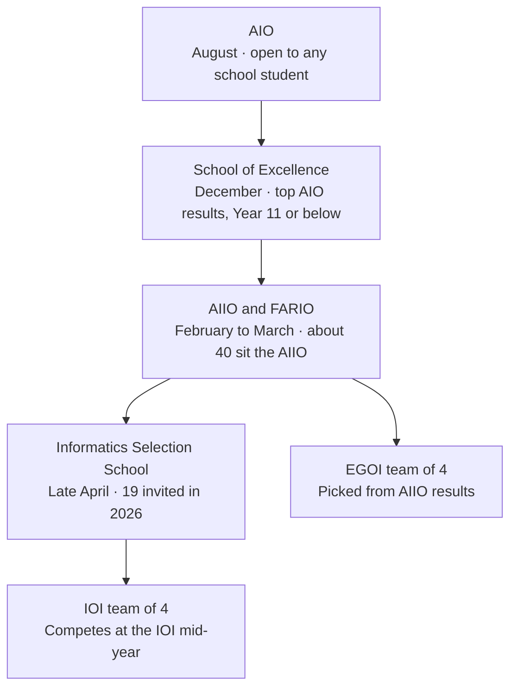

# Australian IOI Team Selection Pathway

As of 1 October 2026

## Overall selection process

Australia sends four students to the International Olympiad in Informatics (IOI) each year. They are chosen through a four-stage pipeline that runs from August to April, and the Australian Maths Trust (AMT) runs every stage.

Only the first stage is open. Every later stage is by invitation, based on results in the stage before. The School of Excellence is the hard gate: it is limited to students in Year 11 or below, and every national team member comes from that group.

Each arrow is an invitation based on results in the stage before; the AIIO also feeds the EGOI team.

| Stage | When | Who | Format | Size |
| --- | --- | --- | --- | --- |
| 1. AIO | August (27 Aug in 2026) | Any school student with some programming experience | Online competition, 3 hours | Open entry |
| 2. School of Excellence | December (ANU, Canberra in 2025) | Top AIO performers, Year 11 or below | Live-in training school | Not published |
| 3. AIIO and FARIO | Feb–Mar | Invited IOI candidates; AIIO includes NZ students | Invitational competitions | About 40 (AIIO) |
| 4. Informatics Selection School | Late April (23 Apr–1 May 2026, UNSW Sydney) | Top invitational performers | Live-in school with selection exams | 19 invited in 2026 |
| IOI | August (Tashkent, Uzbekistan in 2026) | The national team | International competition, 2 days | 4 |

The AIIO also selects four students for the European Girls' Olympiad in Informatics (EGOI). Sizes vary each year and are not fixed quotas.

## Stage 1: Australian Informatics Olympiad (AIO)

The AIO is the only open stage, and the score here decides who is invited to the December School of Excellence.

| Item | Detail |
| --- | --- |
| Timing | Late August each year; 27 August 2026 (entry deadline 21 August) |
| Target audience | Any Australian school student who can already write code |
| Divisions | Intermediate (up to Year 10) and Senior (up to Year 12); one shared paper, divisions only affect awards |
| Format | Competition: 6 problems in 3 hours, online, entered through the school (AUD 25.90 per student in 2026) |
| Languages | C11, C++11, Java 11, Python 3.10 |
| Scoring | Each problem is worth 100 points, split into subtasks; the best submission counts |
| Awards | Gold (top 10%), Silver (next 15%), Bronze (next 25%), Credit (next 20%), Participation |
| Syllabus | None published; problems assume general programming ability |

**Knowledge and skills required**

- Fluent programming in one language, including arrays, loops, functions and reading input fast.
- Problems 1–3: simulation, enumeration (brute force) and careful case handling.
- Problems 4–6: sorting, greedy with an exchange argument, binary search and binary search on the answer, prefix sums and difference arrays, two pointers.
- Occasional topics in Problems 5–6: BFS on graphs, simple dynamic programming, sparse tables, parity arguments.
- Subtask strategy: writing a brute-force solution for the small cases first, then improving it.
- Complexity analysis: estimating whether O(N log N) or O(N²) fits the limits.

The topic list for Problems 5–6 is drawn from past AIO papers from 2019 to 2026 (see the AIO P6 teaching notes in this project). AMT does not publish the score needed for a School of Excellence invitation.

## Stage 2: School of Excellence

The School of Excellence is where students first meet university-level algorithms, and only its invitees can later make the IOI team.

| Item | Detail |
| --- | --- |
| Timing | December, about ten days; held at the Australian National University, Canberra, in 2025 |
| Target audience | Students in Year 11 or below with exceptional AIO results; past invitees range from Year 7 to Year 11 |
| Format | Invitation-only live-in training school: lectures, labs, practice contests |
| Size | Not published; early programs took about 12 students |
| Syllabus | No official syllabus published; described as advanced algorithmic material, often second- or third-year university computer science |

**Knowledge and skills required on arrival**

- Everything in Stage 1, solid enough to code it quickly and without bugs.
- C++ is the practical choice from here on, since the IOI accepts only C++ and invitational problems often need its standard library and speed.
- Comfort with recursion and with reading and writing proofs of why a greedy or binary search works.

**What students are expected to learn there**

AMT does not publish the course outline. The material that the next stage assumes, and that the IOI syllabus lists, is:

- Graphs: representation, BFS and DFS, shortest paths (Dijkstra), minimum spanning trees, topological sort, union-find.
- Dynamic programming: the standard patterns (knapsack, intervals, on trees, over subsets).
- Data structures: heaps and priority queues, Fenwick trees, segment trees, balanced binary search trees (std::set, std::map).
- Trees: traversal, lowest common ancestor, binary lifting.

The main goal is to move a student from "can solve AIO Problem 6" to "can attempt invitational problems" by the February AIIO, about eight weeks later.

## Stage 3: Invitational contests (AIIO and FARIO)

These two contests are the main evidence used to choose who goes to the April Selection School, and the AIIO also picks the EGOI team.

| Item | AIIO | FARIO |
| --- | --- | --- |
| Full name | Australian Invitational Informatics Olympiad | French-Australian Regional Informatics Olympiad |
| Timing | February | March (annual) |
| Target audience | Invited students from Australia and New Zealand, about 40 a year | Potential IOI candidates and other interested students from France, Australia, New Zealand and Belgium |
| Format | Invitation-only competition; 3 problems a paper in 2021–2024, 4 in 2025 (from ORAC sets) | Competition sat remotely |
| Role in selection | Picks Selection School invitees; also picks 4 students for EGOI | Described by AMT as one of the main competitions used to select the IOI team |
| Syllabus | None published; assumes familiarity with a range of common algorithms and data structures | None published |

**Knowledge and skills required**

The AIIO solutions in this project (2023–2025) show the level expected:

| Topic | Example problems |
| --- | --- |
| Dijkstra with a heap, including multi-source | 2023 P2 Electrical Fault, 2024 P2 Overcycle |
| BFS from every node, two pointers, greedy | 2025 P3 Amazing Game II |
| Segment tree with point updates and range max and min | 2024 P1 Speed Friending |
| Monotonic stack, sparse table, prefix sums | 2023 P3 Pinnacle |
| Dynamic programming (prefix-best, 0/1 knapsack) | 2023 P1 Sculpture III, 2025 P2 Retail Empire |
| Permutation cycles, lower-bound proofs, construction | 2024 P3 Curator Catastrophe |
| Interactive problems through a provided interface | 2025 P4 Kth Number |

Beyond the topics, these contests reward:

- Finding the key observation that reduces a problem to a standard technique.
- Proving a greedy step or a lower bound, not just guessing it.
- Collecting subtask points under time pressure when the full solution is out of reach.

Past AIIO and FARIO papers are on ORAC and are the closest practice for this stage.

## Stage 4: Informatics Selection School

The Selection School is the final step: the four-student IOI team is chosen at its end.

| Item | Detail |
| --- | --- |
| Timing | Late April; 23 April to 1 May 2026 |
| Location | UNSW, Sydney, in 2026 |
| Target audience | Students invited on their AIIO and FARIO results; 19 students in Years 8–12 in 2026 |
| Format | Invitation-only live-in school with training and IOI-style selection exams |
| Outcome | The IOI team of four is announced at the end of the school |
| Syllabus | None published; problems are pitched at IOI difficulty |

Students who reached the School of Excellence before Year 12 can still attend the Selection School in Year 12, as the 2026 list shows.

**Knowledge and skills required**

- The full set of Stage 2 and Stage 3 techniques, fast and reliable under exam conditions.
- Applying known algorithms in creative and unusual ways rather than learning new ones; this is the stated focus of the school.
- IOI-style task handling: function-based interfaces (grader files instead of standard input), interactive tasks, and output-only tasks.
- Strategy for long, IOI-length papers: reading all problems first, banking subtask points, and choosing when to stop on a problem.
- Consistency across several exams in the same week.

AMT does not publish how exams at the school are weighted against earlier contest results.

## Final stage: the IOI

The four selected students represent Australia at the IOI, which in 2026 was held in Tashkent, Uzbekistan, in August.

| Item | Detail |
| --- | --- |
| Timing | Mid-year, usually July to September; August in 2026 |
| Target audience | National teams of up to 4 secondary school students per country |
| Format | Competition over 2 contest days, 3 tasks a day, 5 hours a day, in C++ |
| Syllabus | The official IOI Syllabus, updated each year by the International Scientific Committee |

**Knowledge and skills required**

The IOI Syllabus sorts topics into levels, from prerequisite knowledge that may appear without explanation to topics that are explicitly excluded. Topics it includes for solutions:

- Graphs: BFS, DFS, topological sort, connected and strongly connected components, Euler paths, biconnectivity, shortest paths (Dijkstra, Bellman-Ford, Floyd-Warshall), minimum spanning trees (Prim, Kruskal), bipartite matching, maximum flow.
- Dynamic programming: standard approaches.
- Data structures: binary heaps, union-find, binary search trees and balanced search trees, Fenwick trees, segment trees, tries.
- Geometry: vector operations, convex hull, sweep line.

Use the current syllabus PDF for the exact list, since it changes from year to year.

## Caveats and sources

AMT publishes dates and formats but not the selection weightings, cut-off scores or a syllabus for any Australian stage. The "knowledge and skills" lists for the AIO and AIIO come from the solved problems in this project; those for the schools are inferred from what the next stage assumes. Check citizenship or residency rules with AMT directly.

- [AIO overview, 2026 dates and awards (AMT)](https://amt.edu.au/aio)
- [AIO competition format and judging](https://aio.edu.au/rules_format/)
- [AIO technical details: languages and limits](https://aio.edu.au/rules_technical/)
- [AIO FAQ: School of Excellence and team pathway](https://aio.edu.au/faq/)
- [AIIO (AMT)](https://amt.edu.au/australian-invitational-informatics-olympiad-aiio)
- [AIIO problem sets on ORAC](https://orac.amt.edu.au/hub/aiio/)
- [FARIO (AMT)](https://amt.edu.au/french-australian-regional-informatics-olympiad-fario)
- [2026 Informatics Selection School invitees (AMT)](https://amt.edu.au/olympiads/congratulations-to-students-attending-our-invitational-training-camps)
- [2025 School of Excellence at ANU (Creator Academy)](https://www.creatoracademy.edu.au/blogs/creator-academy/celebrating-excellence-in-coding-one-of-our-students-selected-for-the-amt-school-of-excellence)
- [How to qualify for the AIO (Ace Achievers)](https://aceachievers.com.au/resources/how-to-qualify-for-australian-informatics-olympiad.html)
- [Benjamin Burton, Informatics Olympiads: Challenges in Programming and Algorithm Design (2008)](https://people.smp.uq.edu.au/BenjaminBurton/papers/burton08-challenges.pdf)
- [IOI Syllabus 2025](https://ioinformatics.org/files/ioi-syllabus-2025.pdf)
- [IOI 2026, Tashkent](https://ioinformatics.org/page/ioi-2026/61)

## Appendix: IOI syllabus summary

The IOI Syllabus (2025 edition, the latest published) rewards depth in a fixed core of graphs, dynamic programming and data structures. It explicitly rules out string-matching algorithms, hash tables, FFT and most advanced mathematics.

Every topic carries one of six levels:

| Marker | Level | Meaning |
| --- | --- | --- |
| ✓ | Included, unlimited | Basic knowledge; can appear in a task without explanation |
| ✓q | Included, to be defined | Can appear, but the task statement must define it |
| ✓p | Included, not for task description | Needed to solve tasks, but not named in statements |
| ? | Outside of focus | Not expected; a task may use it only if solvable without prior knowledge |
| ✗? | Excluded, open to discussion | Excluded for now, under review |
| ✗ | Explicitly excluded | Will not be needed; knowing it gives no advantage |

| Area | Included (✓, ✓q, ✓p) | Outside of focus (?) | Excluded (✗) |
| --- | --- | --- | --- |
| Arithmetic and geometry | Integers, parity, divisibility; modular addition, subtraction, multiplication; fractions; points, vectors, polygons in the plane; primes; Euclidean distance; Pythagoras | — | 3D geometry; floating-point precision work; modular division and inverses; complex numbers; conics; trigonometry |
| Discrete mathematics | Functions, relations, sets; basic logic; proofs including induction; counting (permutations, combinations, binomial coefficients, inclusion-exclusion, pigeonhole); graph and tree vocabulary; centroids; planar graphs | Discrete probability (finite cases) | Solving recurrences; Burnside lemma; hypergraphs; treewidth; linear algebra and FFT; calculus; statistics |
| Programming fundamentals | Language basics, arrays, strings, recursion, divide and conquer, backtracking, linked structures, pointers, simple floating point; interacting with a reactive environment (interactive tasks) | Memory representation; heap allocation; exact fractions | Non-trivial floating-point calculations |
| Analysis and strategies | Big O; amortized analysis; brute force; greedy; divide and conquer; branch and bound; dynamic programming | Heuristics; randomized and approximation algorithms | Average-case analysis; recurrence-based analysis; clustering; numerical optimization |
| Algorithms | Binary search; quickselect; O(n log n) sorting; simple string algorithms; big integers; DFS and BFS; connected components; transitive closure; shortest paths; minimum spanning trees; bipartite matching; maximum flow; biconnectivity; strongly connected components; basic game analysis | — | Faster matching and flow implementations; general-graph matching; min-cost flow; matroids; alpha-beta pruning; Nim and Sprague-Grundy theory |
| Data structures | Stacks, queues; binary heaps; union-find; balanced, statically balanced and augmented binary search trees (covers segment trees and Fenwick trees); LCA in O(log n); tree decomposition; persistent structures; nested structures; tries | — | KMP, Rabin-Karp, suffix arrays and trees, Aho-Corasick; hash tables; complex heap variants; 2D tree structures; structures for dynamically changing trees |
| Geometric algorithms | Points, vectors, lines; collinearity and clockwise turns; line intersection; polygon area; point in polygon; coordinate compression; convex hull; sweep line | — | Point-line duality; Voronoi and Delaunay; circle intersections; 3D linear programming |
| Other computing | Software engineering basics: APIs, testing, debugging, using an IDE | Distributed, parallel and cryptographic algorithms; finite automata and regular expressions | Computability; NP-hardness proofs |

Source: [IOI Syllabus 2025](https://ioinformatics.org/files/ioi-syllabus-2025.pdf).
